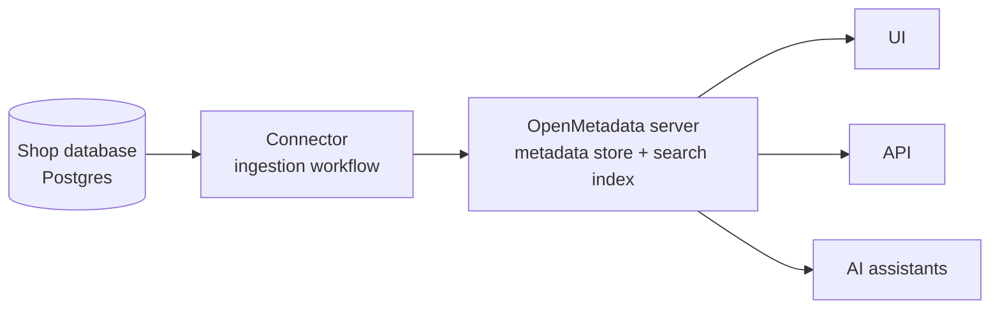
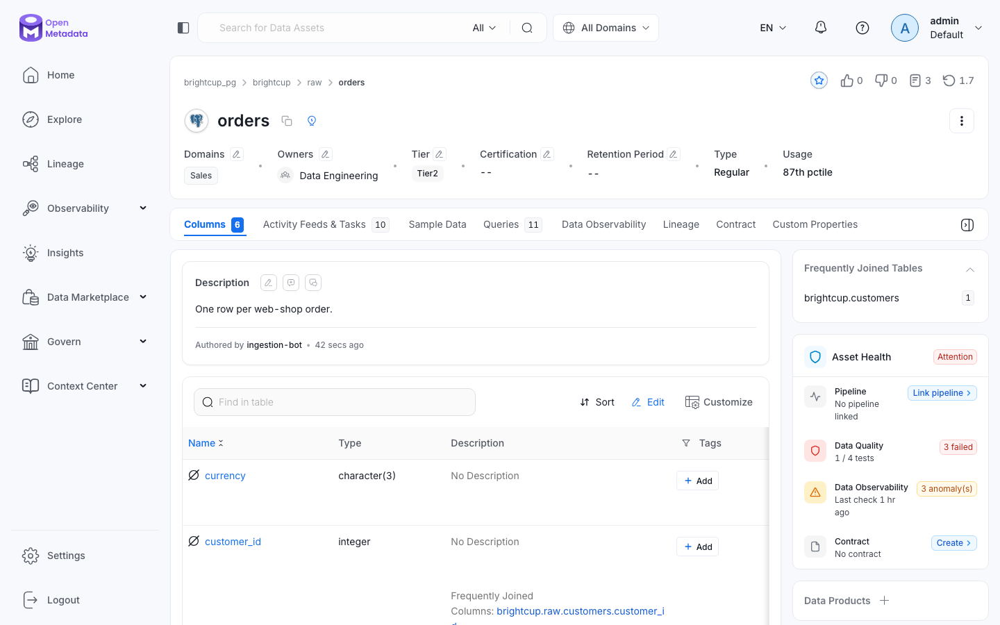

# 00 — Quick grasp: what OpenMetadata is

**What you will learn**

- What OpenMetadata is and the one problem it solves (people cannot find, understand or trust the data they have).
- How it works in 4 steps: register a source as a service → a connector reads metadata (not the data) → the server stores it and indexes it for search → people and programs search, read and enrich it.
- When to use it, and when it is overkill.
- How to start the local stack, get a bot token, run one metadata ingestion, and find `raw.orders` by search, API and UI.

This chapter is Level 0 of the tutorial's levels tree: the big picture itself. It answers one question — *what is OpenMetadata, and what does one full pass through it look like?* — before any detail. Chapters 01 and 02 complete this picture; chapters 03 and later open up the machinery.

## What it is, in plain words

OpenMetadata (open-metadata.org) is an open-source metadata platform — a data catalog plus lineage, data quality and governance in one place — built by Collate and released under Apache 2.0.

The problem, in Brightcup words: Brightcup is a small online coffee-bean shop. Its finance team's dashboard shows revenue, but nobody knows which table that number comes from, whether the underlying data is correct, or who to ask about it. That is the one problem OpenMetadata solves: **people cannot find, understand or trust the data they already have.**

> **What it is:** metadata is data *about* data: table and column names, types, descriptions, owners, query history and statistics. It is everything you need to find and judge a dataset, without the rows themselves.
> **What it means for us:** OpenMetadata reads names, columns, types, comments, query logs and statistics from your systems. It never copies the table rows into the server.
> **Why it matters:** the fear that blocks adoption is "you want to copy our production database?". The answer is no — cataloging works with a read-only user. (Two opt-in exceptions do read rows: *sample data* — storing a few example rows so people can eyeball a table — and *profiling* — scanning the rows to compute statistics such as row counts and null counts. Both are off here; chapter 07 turns them on and says exactly what they touch.)

How it works, at the highest level, in 4 steps:



1. You register a source system (here, the shop's Postgres) as a **service**.
2. A **connector** — code that knows how to read one kind of system — runs as an **ingestion workflow** and sends the metadata to the server.
3. The server stores the metadata and indexes it so it is searchable.
4. People search and read it in the UI; programs and AI assistants read it through the API. Both sides also enrich it: descriptions, owners, tests, tags.

When to use it: several data sources and several teams, where the questions "where is the revenue data?", "what does this column mean?", "who owns it, can I trust it?" keep coming up. When it is overkill: one database and three people sitting together — comments in SQL and a shared chat channel may be enough.

The rest of this chapter runs the whole mechanism once at the smallest size: one database, one connector run, one table found three ways. All commands run from `project/`.

## The stack up and healthy

```bash
just up
```

Real output (the stack was already built, so this returns quickly; a first start pulls images and takes ~3 minutes; readiness chatter cut with `...`):

```
docker compose up -d
 Container om-tutorial-shopdb Running
 Container om-tutorial-webhook Running
 Container om-tutorial-search Running
 Container om-tutorial-metadb Running
 Container om-tutorial-server Running
 Container om-tutorial-ingestion Running
 ...
 Container om-tutorial-migrate Exited
 ...
waiting for om-tutorial-server to become healthy...
waiting for the ingestion container (airflow) to answer...
stack is up: http://localhost:18585 (admin@open-metadata.org / admin)
```

Seven containers in `docker compose ps -a` (plain `docker compose ps` lists only the six running services), each doing one thing — the OpenMetadata server serves the UI and the API on port 18585 (login `admin@open-metadata.org` / `admin`, local only); its own Postgres database on port 15432 is the metadata store that holds every asset durably (chapter 03 opens it up); Elasticsearch on port 19200 is the search index that makes everything searchable (chapter 03 opens it up); the ingestion container runs Airflow on port 18080, which schedules and executes connector runs (chapters 03–04 open it up); the shop database is Postgres on port 15433 holding Brightcup's tables; a small webhook receiver on port 18090 waits for alerts (chapter 09 uses it) — plus `om-tutorial-migrate`, a one-shot job that applies the server's database migrations and then exits. That is why it shows as `Exited`, not `Running`, and appears only with `docker compose ps -a`: the "7 containers" count holds while only six serve traffic.

```bash
just check
```

Real output:

```
uv run python -m openmetadata_tutorial.check
OK   openmetadata server            2.0.5
OK   search index                   10 tables indexed
OK   ingestion (airflow)            healthy
OK   shop database                  customers=200, products=30, orders=1000, order_items=2550
OK   webhook receiver               up
OK   ingestion-bot token in .env    set
```

What it means for us: the server answers and reports version 2.0.5; the search index holds 10 tables on this run — expect a different number on yours, and do not memorize it: every chapter catalogs extra tables under its own names on our shared stack, so the count only grows. The stable part is the 7 Brightcup tables from the plan (4 raw tables, 2 views, `customer_ltv`), which are always among them. Airflow is healthy; the shop database holds exactly the plan's rows (200 customers, 30 products, 1,000 orders, 2,550 order items); the webhook is up; and a bot token is ready in `.env`.

How heavy is "heavy"? Measured right now:

```bash
docker stats --no-stream --format "table {{.Name}}\t{{.MemUsage}}" | grep -E "NAME|om-tutorial"
```

Real output:

```
NAME                          MEM USAGE / LIMIT
om-tutorial-shopdb            27.13MiB / 41.07GiB
om-tutorial-ingestion         2.049GiB / 41.07GiB
om-tutorial-server            1.172GiB / 41.07GiB
om-tutorial-webhook           15.94MiB / 41.07GiB
om-tutorial-metadb            225.9MiB / 41.07GiB
om-tutorial-search            2.339GiB / 41.07GiB
```

What it means for us: the six running containers use about 5.8 GiB together (2.049 + 1.172 + 2.339 GiB for ingestion, server and search, plus ~270 MiB for the rest) — that is where the "about 6 GB" below comes from. Expect a nearby number on yours, not this exact one: usage moves with load.

A limit to keep in mind: this is a single-node, no-TLS, basic-auth local stack (`admin` / `admin`) — fine for learning on your own machine and for nothing else. Real deployments add TLS, SSO and sizing; chapter 03 covers how.

> **Important:** the stack is heavy: about 6 GB of RAM for Docker (5.8 GiB measured above), 7 containers in `docker compose ps -a` (six running plus the one-shot migrate), ~3 minutes for the first start.
> **What it means for us:** give Docker enough memory before `just up`, and do not judge a failure until the healthchecks pass.
> **Why it matters:** on a small laptop Elasticsearch exits first and the server then fails in confusing ways that look like a bug in OpenMetadata.

## One ingestion: reading the shop's metadata

Programs talk to the server with a token, not the admin password:

```bash
just token
```

Real output:

```
uv run python -m openmetadata_tutorial.write_token
OM_JWT_TOKEN written to .env (760 chars, starts eyJraWQiOiJH...)
```

> **What it is:** the bot token is a JWT (a signed login slip) for the machine user `ingestion-bot`, stored in `project/.env` as `OM_JWT_TOKEN`.
> **What it means for us:** every connector run and API call in this tutorial presents this token; humans keep using the UI login.
> **Why it matters:** a token is scoped to a machine user and can be re-issued (`just token` again) without touching anyone's password.

Now the one connector run. This is the entire workflow definition, `project/ingestion/metadata.yaml`:

```yaml
source:
  type: postgres
  serviceName: brightcup_pg
  serviceConnection:
    config:
      type: Postgres
      username: ${SHOP_READER_USER}
      authType:
        password: ${SHOP_READER_PASSWORD}
      hostPort: shopdb:5432  # the shop database as seen inside Docker
      database: brightcup
  sourceConfig:
    config:
      type: DatabaseMetadata
      includeTables: true
      includeViews: true
      markDeletedTables: true
      schemaFilterPattern:
        includes:
          - ^raw$
          - ^analytics$
sink:
  type: metadata-rest
  config: {}
workflowConfig:
  loggerLevel: INFO
  openMetadataServerConfig:
    hostPort: http://openmetadata-server:8585/api  # the server as seen inside Docker
    authProvider: openmetadata
    securityConfig:
      jwtToken: ${OM_JWT_TOKEN}
```

In plain words: *source* says which system and how to connect (Postgres, the `brightcup` database, as the read-only `om_reader` user); *sourceConfig* says what to read (tables and views, only the `raw` and `analytics` schemas); *sink* says where to write (the server's REST API); *workflowConfig* says which server and which token. The `${...}` placeholders are filled from `.env` at run time, so secrets never land in a file.

```bash
just ingest metadata
```

Real output (the `uv` launcher `VIRTUAL_ENV ... will be ignored` warning and ANSI colour codes dropped; the capability checks and both summaries are the point):

```
/home/airflow/.local/lib/python3.12/site-packages/metadata/ingestion/source/database/postgres/models.py:20: UserWarning: Field name "schema" in "PostgresStoredProcedure" shadows an attribute in parent "BaseModel"
  class PostgresStoredProcedure(BaseModel):
[2026-10-12 12:16:07] INFO     {metadata.OMetaAPI:server_mixin:159} - OpenMetadata client running with Server version [2.0.5] and Client version [2.0.5.0]
[2026-10-12 12:16:07] INFO     {metadata.Ingestion:runner:98} - CheckAccess: Passed
[2026-10-12 12:16:07] INFO     {metadata.Ingestion:runner:98} - GetDatabases: Passed
[2026-10-12 12:16:07] INFO     {metadata.Ingestion:runner:98} - GetSchemas: Passed
[2026-10-12 12:16:07] INFO     {metadata.Ingestion:runner:98} - GetTables: Passed
[2026-10-12 12:16:07] INFO     {metadata.Ingestion:runner:98} - GetViews: Passed
[2026-10-12 12:16:07] INFO     {metadata.Ingestion:runner:98} - GetTags: Passed
[2026-10-12 12:16:07] INFO     {metadata.Ingestion:runner:98} - GetQueries: Passed
[2026-10-12 12:16:07] INFO     {metadata.Ingestion:runner:98} - GetColumnMetadata: Passed
[2026-10-12 12:16:07] INFO     {metadata.Ingestion:runner:98} - GetTableComments: Passed
[2026-10-12 12:16:07] INFO     {metadata.Ingestion:runner:98} - GetInformationSchemaColumns: Passed
[2026-10-12 12:16:07] INFO     {metadata.Ingestion:runner:105} - Test connection for 'Postgres': Successful
[2026-10-12 12:16:08] INFO     {metadata.Ingestion:common_db_source:163} - Ingesting from database: brightcup
[2026-10-12 12:16:08] INFO     {metadata.Ingestion:database_service:763} - Mark Deleted Tables set to True. Processing database [brightcup]
[2026-10-12 12:16:08] INFO     {metadata.Ingestion:database_service:780} - Mark Deleted Stored Procedures Processing database [brightcup]
[2026-10-12 12:16:08] INFO     {metadata.Utils:logger:223} - Workflow Postgres Summary:
[2026-10-12 12:16:08] INFO     {metadata.Utils:logger:223} - Processed records: 11
[2026-10-12 12:16:08] INFO     {metadata.Utils:logger:223} - Updated records: 0
[2026-10-12 12:16:08] INFO     {metadata.Utils:logger:223} - Warnings: 0
[2026-10-12 12:16:08] INFO     {metadata.Utils:logger:223} - Filtered: 3
[2026-10-12 12:16:08] INFO     {metadata.Utils:logger:223} - Errors: 0
[2026-10-12 12:16:08] INFO     {metadata.Utils:logger:223} - Success %: 100.0
[2026-10-12 12:16:08] INFO     {metadata.Utils:logger:223} - Workflow OpenMetadata Summary:
[2026-10-12 12:16:08] INFO     {metadata.Utils:logger:223} - Processed records: 12
[2026-10-12 12:16:08] INFO     {metadata.Utils:logger:223} - Updated records: 0
[2026-10-12 12:16:08] INFO     {metadata.Utils:logger:223} - Warnings: 0
[2026-10-12 12:16:08] INFO     {metadata.Utils:logger:223} - Errors: 0
[2026-10-12 12:16:08] INFO     {metadata.Utils:logger:223} - Success %: 100.0
[2026-10-12 12:16:08] INFO     {metadata.Utils:logger:223} - Workflow Success %: 100.0
[2026-10-12 12:16:08] INFO     {metadata.Utils:logger:223} - Workflow finished in time: 565.773ms
```

What it means for us: every capability check passed, including the connectivity check against Postgres (`Test connection for 'Postgres': Successful`), and the run finished with `Workflow Success %: 100.0` and zero errors. The run prints two summaries because it counts from both ends: `Workflow Postgres Summary` counts the metadata records the connector read, `Workflow OpenMetadata Summary` counts the records the sink wrote to the server. Both count metadata records — databases, schemas, tables, views — never data rows: the 1,000 order rows do not appear here. On this run the connector side read 11: 1 database (`brightcup`) + 2 schemas matched by the filter (`raw`, `analytics`) + 8 tables and views currently in them (the plan's 7 plus chapter 06's `ch06_dynamic`, which sits in `analytics` — the search output below shows it). `Filtered: 3` are the schemas outside the filter, skipped unread: the connector considers only non-system schemas, and of those five (`analytics`, `information_schema`, `public`, `raw`, `sandbox` — chapter 04 shows how to recount them) only `raw` and `analytics` match. Do not memorize the 11: as chapters add tables under their own names, it grows — recount yours the same way. Nothing was updated (`Updated records: 0`) because the server already held these assets from the shared bootstrap; re-running an ingestion workflow is *idempotent* — running it twice has the same effect as running it once, so a re-run recognizes what is already there instead of duplicating it.

> **Important:** the connector reads metadata, not data.
> **What it means for us:** you can catalog a production database with a read-only user; the server holds names, comments and statistics, never the rows.
> **Why it matters:** people fear "copying prod" and block adoption — this is the sentence that unblocks it. But sample data and profiling do read rows (chapter 07 says exactly what they touch).

> **Important:** client and server versions must match: `openmetadata-ingestion==2.0.5.0` with server 2.0.5.
> **What it means for us:** the log line "Server version [2.0.5] and Client version [2.0.5.0]" is the proof to look for on every run.
> **Why it matters:** a mismatched client fails or, worse, silently mis-parses what the server sends.

> **Important:** ingestion runs inside the ingestion container, so addresses are Docker addresses.
> **What it means for us:** the YAML says `shopdb:5432` and `http://openmetadata-server:8585/api`, never `localhost` with host ports.
> **Why it matters:** the host address is stored on the service and reused by UI-scheduled runs on Airflow; a `localhost` value works from your laptop and breaks from inside Docker.

## Finding `raw.orders` three ways

The metadata is in. Now find one table — `raw.orders`, the 1,000 order rows everything downstream is built from — through search, through the API, and in the UI.

**Search.** (`just api` already pipes through `jq`, so here `curl` + `jq` show names only; run after `set -a; source .env; set +a` so the token is loaded from `project/`):

```bash
curl -s -H "Authorization: Bearer $OM_JWT_TOKEN" "$OM_URL/api/v1/search/query?q=orders&index=table_search_index&size=10" | jq '{hits: [.hits.hits[]._source | {name, fqn: .fullyQualifiedName}]}'
```

Real output:

```json
{
  "hits": [
    {
      "name": "orders",
      "fqn": "brightcup_pg.brightcup.raw.orders"
    },
    {
      "name": "order_items",
      "fqn": "brightcup_pg.brightcup.raw.order_items"
    },
    {
      "name": "fct_orders",
      "fqn": "brightcup_pg.brightcup.analytics.fct_orders"
    },
    {
      "name": "daily_revenue",
      "fqn": "brightcup_pg.brightcup.analytics.daily_revenue"
    },
    {
      "name": "customer_ltv",
      "fqn": "brightcup_pg.brightcup.analytics.customer_ltv"
    },
    {
      "name": "ch06_dynamic",
      "fqn": "brightcup_pg.brightcup.analytics.ch06_dynamic"
    }
  ]
}
```

What it means for us: the search index answers "where is the orders data?" in tens of milliseconds — timed at 71 ms on this run (below) — and `orders` is the top hit. Do not rely on the order of the rest: ranking below the top hit shifts as the catalog grows and between runs (a re-run on this shared stack ranked `fct_orders` second). What holds is that every order-related asset surfaces — the raw tables plus the downstream views built from them. (`ch06_dynamic` is a table another chapter adds under its own name on our shared stack — search sees everything cataloged, not just our chapter.)

```bash
curl -s -o /dev/null -w "time_total=%{time_total}s size=%{size_download}B\n" -H "Authorization: Bearer $OM_JWT_TOKEN" "$OM_URL/api/v1/search/query?q=orders&index=table_search_index&size=10"
```

Real output:

```
time_total=0.070569s size=51771B
```

What it means for us: the same search query the JSON above came from completes in about 70 ms wall-clock on this machine — that is the "in milliseconds" claim, measured, not guessed. Expect a nearby number on yours, not this exact one: timing moves with load and caching.

**The asset itself, by API:**

```bash
curl -s -H "Authorization: Bearer $OM_JWT_TOKEN" "$OM_URL/api/v1/tables/name/brightcup_pg.brightcup.raw.orders?fields=columns" | jq '{name, fullyQualifiedName, description, columns: [.columns[] | {name, dataType}]}'
```

Real output:

```json
{
  "name": "orders",
  "fullyQualifiedName": "brightcup_pg.brightcup.raw.orders",
  "description": "One row per web-shop order.",
  "columns": [
    {
      "name": "order_id",
      "dataType": "INT"
    },
    {
      "name": "customer_id",
      "dataType": "INT"
    },
    {
      "name": "order_ts",
      "dataType": "TIMESTAMP"
    },
    {
      "name": "status",
      "dataType": "TEXT"
    },
    {
      "name": "total_amount",
      "dataType": "NUMERIC"
    },
    {
      "name": "currency",
      "dataType": "CHAR"
    }
  ]
}
```

> **What it is:** the FQN (fully qualified name) is the dotted unique name of anything cataloged: `service.database.schema.table`.
> **What it means for us:** `brightcup_pg.brightcup.raw.orders` is the one key used everywhere — in the UI URL, in API paths (`/v1/tables/name/<FQN>`), and in the workflow YAMLs.
> **Why it matters:** two databases can both have a table called `orders`; the FQN is what keeps them apart.

What it means for us: one GET by FQN returns the table's name, its 6 columns with types, and the description "One row per web-shop order." — which came from the Postgres `COMMENT ON TABLE raw.orders` in `shopdb/init/01_schema.sql`, carried into the server by the ingestion run. Descriptions written once in the database show up everywhere the asset is read.

**In the UI.** One real screenshot of the table page:

```bash
just shot /table/brightcup_pg.brightcup.raw.orders assets/00_orders_page.png
```

Real output:

```
saved /Users/sergii/.ai/knowledge/tutorials/openmetadata/assets/00_orders_page.png
```



Three things to look at: the breadcrumb (`brightcup_pg › brightcup › raw › orders`) is the FQN you just used in the API call; the description "One row per web-shop order." is the Postgres comment from the previous paragraph; below it are the columns. (The page also shows ownership, tier and quality badges that later chapters add on this shared stack — chapters 07 and 08 explain each of them; they are named here only so nothing later looks unfamiliar.)

## What just happened

1. We registered the shop database as the service `brightcup_pg` (step 1 of the 4-step mechanism).
2. The Postgres connector ran one ingestion workflow and sent the shop's schemas, tables and views to the server (step 2).
3. The server stored them and indexed them for search (step 3).
4. We read them back three ways — search, API, UI — and will enrich them in later chapters (step 4).

## Carry forward

- OpenMetadata is a **server that holds metadata**; connectors fill it, people and programs read and enrich it.
- Everything has an **FQN** (`service.database.schema.table`) — the key you use in the UI URL, the API and the YAMLs.
- An **ingestion workflow** is a YAML: source + what to read + sink + server/token; we run them with `just ingest <name>`.
- The next chapter answers "so what can I do with it?" — the five jobs.
