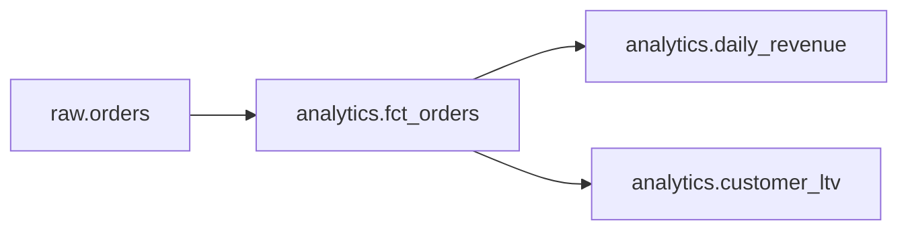

# 01 — The five problems OpenMetadata solves
Level 1, first half: it zooms into "people and programs search, read and enrich it" from chapter 00 — which problems does it solve?

**What you will learn**
- The five jobs of a metadata platform and the question each answers, on the Brightcup data.
- How one shared run of all workflow types (`just bootstrap`) fills the catalog with structure, lineage, statistics, tags and test results.
- What each job looks like in the API's answer (one small, readable result each).
- Which job solves which everyday pain, and what OpenMetadata does *not* do.

Chapter 00 put one table (`raw.orders`) into an empty catalog. This chapter fills the whole catalog once, then asks five questions about Brightcup — the kind of questions that come up every week on a real data team — and answers each one with a single small API call. Breadth, not depth: every job gets its simplest real example, plus a pointer to the chapter that deepens it. You do not need those later chapters to follow this one.

All commands run from `project/`. They only read: the helper module `project/src/openmetadata_tutorial/ch01_five_questions.py` wraps one API call per job and prints a small result. Re-running anything here is safe (`just bootstrap` is idempotent). Outputs below were run on the shared stack right after `just bootstrap` — with one caveat the whole tutorial shares: later chapters enrich these same assets in place (chapter 08 sets owners and corrects tags; chapter 03's probe demo briefly rewords a description), so a value you see may carry another chapter's fingerprint. Where it does, the section says so instead of pretending the catalog stood still.

## Fill the catalog: `just bootstrap`

One command runs every workflow type once, in order. A **workflow** here means one run of a connector job: it reads something from the shop database and writes it into the catalog. (Treat the six steps as black boxes for now; chapter 04 opens the YAMLs behind them.)

```bash
just bootstrap
```

```
just transform
...
analytics.customer_ltv rebuilt: 200 rows
just ingest metadata
...
[2026-10-12 11:38:21] INFO     {metadata.Utils:logger:223} - Workflow Success %: 100.0
just ingest lineage
...
[2026-10-12 11:38:27] INFO     {metadata.Utils:logger:223} - Workflow Success %: 100.0
just ingest profiler profile
...
[2026-10-12 11:38:48] INFO     {metadata.Utils:logger:223} - Workflow Success %: 100.0
just ingest classify classify
...
[2026-10-12 11:39:00] INFO     {metadata.Utils:logger:223} - Workflow Success %: 95.0
just ingest quality test
...
[2026-10-12 11:39:06] INFO     {metadata.Utils:logger:223} - Workflow Success %: 100.0
```

(Long per-step logs cut to the `...` lines; the `Workflow Success %` lines are printed by the ingestion library itself, not by the tutorial's code. Each `just ingest <name>` line starts that step, and each step ends with its own success line — in this order: metadata, lineage, profiler, classify, quality.)

One step reads 95.0, not 100.0 — and that is itself a shared-stack lesson. The classify run's sampler summary reports one error on `brightcup_pg.brightcup.raw.ch05_scratch`: chapter 05's throwaway asset for its delete/restore demo exists in the catalog but has no table behind it in Postgres, so sampling it fails (`relation "raw.ch05_scratch" does not exist`). The failure is confined to that asset — every shop table classified fine — which is why the run still counts as the catalog fill this chapter needs.

What each step does, in plain words:

| step | what it does | what it puts in the catalog |
|---|---|---|
| `transform` | the shop's "nightly job": rebuilds `analytics.customer_ltv` from customers and orders | the table itself (200 rows), plus a query in the database's query log for lineage to find |
| `metadata` | reads the database structure | schemas, tables, views, columns, types, and the descriptions from Postgres comments |
| `lineage` | parses view SQL and the query log | links: which view or query reads which tables |
| `profiler` | scans the rows and computes statistics | row counts, null counts, distinct counts, min/max per column |
| `classify` | runs automatic PII detection over column names and sampled values | sensitivity tags such as `PII.Sensitive` on columns |
| `quality` | runs 4 checks against `raw.orders` | pass/fail results with messages |

Two phrases to keep: the **query log** is Postgres's own record of queries that ran (kept by the `pg_stat_statements` extension) — the nightly `transform` leaves its `CREATE TABLE AS` there, which is how the lineage step learns about `customer_ltv`. The **profiler** looks at the data itself; every other step looks at structure, SQL text, or names.

What it means for us: after this one run, the catalog holds six *different kinds* of metadata about the same tables, and each of the five jobs below reads one of them. When something looks wrong later, this table tells you which step to re-run.

## 1. Discovery — "where is revenue data?"

The finance team asks where the revenue number lives. Start with the smallest possible search:

```bash
uv run python -m openmetadata_tutorial.ch01_five_questions find revenue
```

```
search 'revenue': 1 hit(s)
  brightcup_pg.brightcup.analytics.daily_revenue
    Revenue and order count per day. Feeds the finance dashboard.
```

One hit, and it is the right one: the **FQN** (fully qualified name, `service.database.schema.table`) tells us exactly which asset this is, and the description arrived from the view's Postgres comment at ingestion time (compare `shopdb/init/03_views.sql`: the comment reads "Revenue and order count per day. Feeds the finance dashboard.").

The same search with a broader word shows ranking — most matching assets first, each with its FQN and description:

```bash
uv run python -m openmetadata_tutorial.ch01_five_questions find orders
```

```
search 'orders': 5 hit(s)
  brightcup_pg.brightcup.raw.orders
    One row per web-shop order.
  brightcup_pg.brightcup.raw.order_items
    One row per ordered product: which order, which product, how many, at what price.
  brightcup_pg.brightcup.analytics.fct_orders
    Orders that were not cancelled, with the customer country.
  brightcup_pg.brightcup.analytics.daily_revenue
    Revenue and order count per day. Feeds the finance dashboard.
  brightcup_pg.brightcup.analytics.customer_ltv
    (no description)
```

What it means for us: search covers names, descriptions, columns, tags and glossary terms, and the top hit for `orders` is the raw table itself — discovery works the way you hope. One asset has no description yet (`customer_ltv`, which the nightly job builds without a comment), which is also information: an asset nobody described is hard to find by words — a catalog gap, not a search failure.

> **Important:** search ranks by text match; it does not understand meaning.
> **What it means for us:** `revenue` finds `daily_revenue` because the word is in its name — a differently-worded asset (say, `turnover_per_day`) would not match unless someone adds the synonym as a description, tag or glossary term.
> **Why it matters:** if you expect Google-style understanding, you will conclude assets are missing when they are merely named differently. (Semantic search over embeddings exists as an option; it is off in this stack.)

## 2. Catalog — "what is in `daily_revenue`, and what does each column mean?"

Found it — now, what *is* it? One call reads the view's columns, types and descriptions:

```bash
uv run python -m openmetadata_tutorial.ch01_five_questions describe
```

```
  order_date      DATE       (no description)
  orders          BIGINT     (no description)
  revenue         NUMERIC    (no description)
```

(Defaults to `brightcup_pg.brightcup.analytics.daily_revenue`; pass an FQN to describe another asset.)

What it means for us: the structure is there — three columns with honest types — but *no column has a description*. Column descriptions arrive from Postgres comments at ingestion time, and these columns never had comments, so the catalog has nothing to carry over. This is the catalog's central bargain: it preserves the meaning people wrote down, and it exposes exactly where nobody wrote anything. Chapter 08 adds the missing meaning (owners, glossary terms, tags); chapter 02 shows this same page in the UI.

## 3. Lineage — "if `raw.orders` changes, what breaks?"

Someone wants to add a column to `raw.orders`. Before touching it: who consumes this table, transitively? One call asks for everything downstream:

```bash
uv run python -m openmetadata_tutorial.ch01_five_questions downstream
```

```
  brightcup_pg.brightcup.raw.orders -> brightcup_pg.brightcup.analytics.fct_orders  [ViewLineage]
  brightcup_pg.brightcup.analytics.fct_orders -> brightcup_pg.brightcup.analytics.daily_revenue  [ViewLineage]
  brightcup_pg.brightcup.analytics.fct_orders -> brightcup_pg.brightcup.analytics.customer_ltv  [QueryLineage]
```

(Defaults to `brightcup_pg.brightcup.raw.orders`, depth 3.) Each row is a **lineage edge**, a "from → to" link between two assets, with its *source*: the two **view lineage** edges were parsed from the views' SQL (`fct_orders` selects from `raw.orders`; `daily_revenue` aggregates `fct_orders`), and the **query lineage** edge was parsed from the query log the nightly job left behind (`customer_ltv` is built by a query, not a view). Drawn as a picture, built from exactly this output:



What it means for us: a change to `raw.orders` reaches the finance number (`daily_revenue`) *and* the `customer_ltv` table, both through `fct_orders`. **Upstream** (sources) and **downstream** (consumers) are the two directions of this graph; here we walked downstream. Chapter 06 shows how each edge is made — view vs query lineage, column-level mappings, and impact analysis.

Two limits, before you lean on this. First, this call walks at most 3 levels down (`downstreamDepth=3`) — the server rejects larger depths (asking for 4 returns a 400 error), so a very long chain needs several calls. Second, lineage shows only links the metadata and lineage workflows actually parsed: a consumer nobody connected (the finance team's real dashboard tool, for example) never appears as a node. Lineage is a map of what the catalog has read, not of the world.

## 4. Data quality — "can I trust `daily_revenue`?"

The dashboard shows a number. Is it right? `daily_revenue` is built from `raw.orders`, so check the tests on `raw.orders`. A **test case** is one check applied to one table or column (each applies one kind of check, a **test definition** such as `columnValuesToBeUnique`); a **test suite** is the group that runs together. Here the suite is 4 checks on `raw.orders`, run by the quality step.

The shop seed data (`openmetadata_tutorial.shop_data`, which generates the CSVs deterministically) contains four known defects on purpose — real data has exactly this kind of dirt, and the tutorial wants the catalog to face it:

| defect in the seed data | rows affected |
|---|---|
| 3 `order_id` values appear twice (1,000 rows, 997 distinct ids) | duplicate orders |
| 5 rows with a negative `total_amount` | impossible amounts |
| 4 rows with the misspelled status `shiped` | a typo of `shipped` |
| 12 `NULL` emails in `raw.customers` | missing contact data |

One limit up front: tests catch only what someone wrote a test for. The suite below covers the three `raw.orders` defects; the `NULL` emails have no test case here (the profiler's null count sees them, and chapter 07 turns that into a test).

```bash
uv run python -m openmetadata_tutorial.ch01_five_questions quality
```

```
  Failed   orders_no_negative_amounts
           Found 5 row(s). Test query is expected to return <= 0 row(s).
  Failed   orders_order_id_unique
           Found valuesCount=1000 vs. uniqueCount=994. Both counts should be equal for column values to be unique.
  Success  orders_row_count_between
           Found rowCount=1000 vs. the expected min=500.0,  max=5000.0.
  Failed   orders_status_in_set
           Found countInSet=996.
```

(Defaults to `brightcup_pg.brightcup.raw.orders`.) What it means for us: 1 of 4 checks passes, 3 fail — and each failure is one row of the defect table. The uniqueness check counts values that appear *exactly once*: 994 of them out of 1,000 rows, so 6 rows share an id with another row (the 3 duplicated ids). The set-membership check found 996 of the 1,000 status values inside the allowed set, so 4 rows fall outside it (the `shiped` typos). The custom SQL check found the 5 negative amounts. Only the row-count sanity check passes. So the answer to "can I trust `daily_revenue`?" is *no, not today*: it is built on a table with duplicate orders, negative amounts and a misspelled status, and its revenue total is wrong by exactly those defects.

> **Important:** a catalog does not fix data; it makes problems visible and routable.
> **What it means for us:** these 3 tests stay red until someone fixes the rows in `raw.orders` — OpenMetadata points at the defect, it does not repair it.
> **Why it matters:** teams buy a catalog expecting cleaner data, then blame the tool when the red stays red. The catalog's job is to turn "the dashboard looks off" into "5 negative amounts in `raw.orders`, failing check `orders_no_negative_amounts`" — a ticket with a name on it.

> **Important:** lineage plus quality together answer "can I trust this number"; either alone does not.
> **What it means for us:** a green test on `daily_revenue` itself would miss every defect upstream — trust has to flow *along* the lineage edges from section 3.
> **Why it matters:** testing only the final table is the most common false comfort in data quality. Chapter 07 deepens tests, suites and incidents.

## 5. Governance — "is this personal data, and who owns it?"

The last question is about responsibility, not numbers. Which columns of `raw.customers` hold personal data, and who owns the table? A **classification** is a family of sensitivity tags (here `PII`); a **tag** is one value in it (`PII.Sensitive`); an **owner** is the user or team responsible for the asset:

```bash
uv run python -m openmetadata_tutorial.ch01_five_questions governance
```

```
  customer_id     (no tags)
  full_name       PII.Sensitive
  email           PII.Sensitive
  phone           PII.NonSensitive
  country         (no tags)
  signup_date     (no tags)
  owners: Data Engineering
```

(Defaults to `brightcup_pg.brightcup.raw.customers`.) What it means for us: the classify workflow found the obvious personal data on its own — names and emails are `PII.Sensitive`, phones `PII.NonSensitive`. And the owner line is already filled — `Data Engineering` — because ownership is a human decision and chapter 08 made it: the raw tables belong to the team that ingests them (the finance number itself belongs to Finance). On a freshly bootstrapped catalog that line reads `(none)`; what you see here is chapter 08's enrichment, not bootstrap output. That decision is what turns a red test into a ticket with an assignee — and making it is chapter 08's whole subject (owners, teams, tiers, glossary, data products).

> **Important:** automatic classification is a suggestion, not a decision.
> **What it means for us:** on a freshly bootstrapped catalog, `signup_date` — a plain registration date — carries `PII.NonSensitive`: a date-shaped-value pattern fires on every `2026-02-26`-style value. Harmless here, but the same machinery can mistag in the costly direction. On this shared stack you see `(no tags)` instead, because chapter 08 already removed that false positive — and re-running bootstrap re-applies it (observed while preparing this chapter), so the correction is standing work, not a one-off.
> **Why it matters:** wrong tags either hide data from people who need it or give false comfort that "PII is handled". Every auto-tag deserves a human glance before it becomes policy. Chapter 08 shows the review flow.

## Where each job lives, and what OpenMetadata is not

| job | Brightcup question | where it shows in OpenMetadata | deepened in |
|---|---|---|---|
| discovery | where is revenue data? | search, Explore page | chapter 02 (UI), 05 (search API) |
| catalog | what is in `daily_revenue`, what does each column mean? | the table page: columns, types, descriptions | chapter 02 (UI), 08 (meaning) |
| lineage | if `raw.orders` changes, what breaks? | the lineage graph, upstream/downstream | chapter 06 |
| data quality | can I trust `daily_revenue`? | test cases, suites, results, incidents | chapter 07 |
| governance | is this personal data, and who owns it? | tags, owners, glossary, tiers, domains | chapter 08 |

And four things OpenMetadata is *not*, so you reach for the right tool: it is not a **query engine** (it never runs your analytics queries), not an **ETL tool** (it does not move or transform rows — the nightly job lives outside it), not a **BI tool** (it does not draw the finance dashboard), and not a **data store** (delete it and Brightcup's rows are untouched; only the metadata goes away).

## Carry forward

- Five jobs — **find, understand, trace, trust, govern** — all on the same entities and FQNs: one catalog, five ways to read it.
- The catalog is filled by **workflows of different types** (metadata, lineage, profiler, classify, quality); each fills one kind of metadata, and the bootstrap table tells you which to re-run when something looks stale.
- Jobs combine: **quality upstream + lineage = trust downstream** — the pattern every later chapter reuses.
