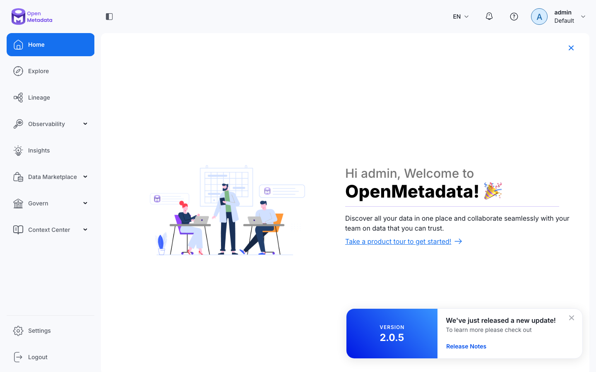
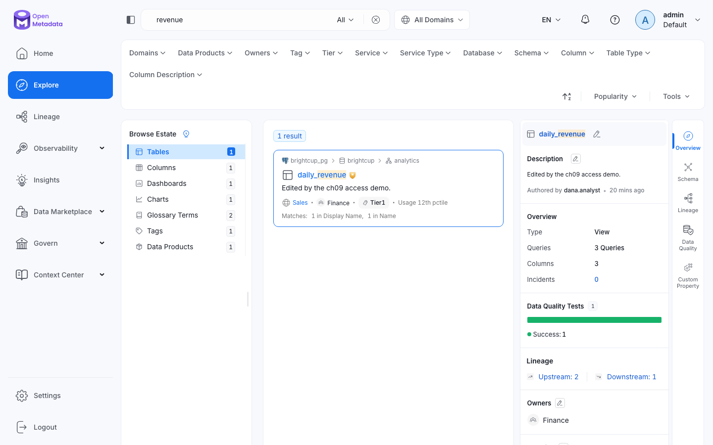
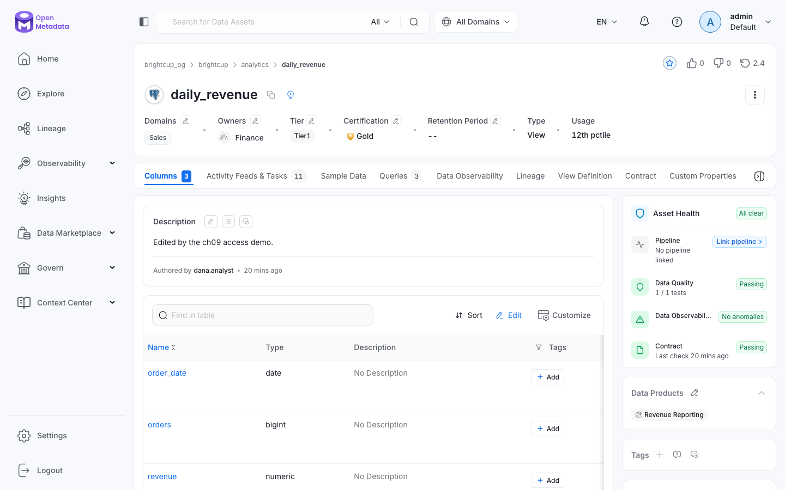
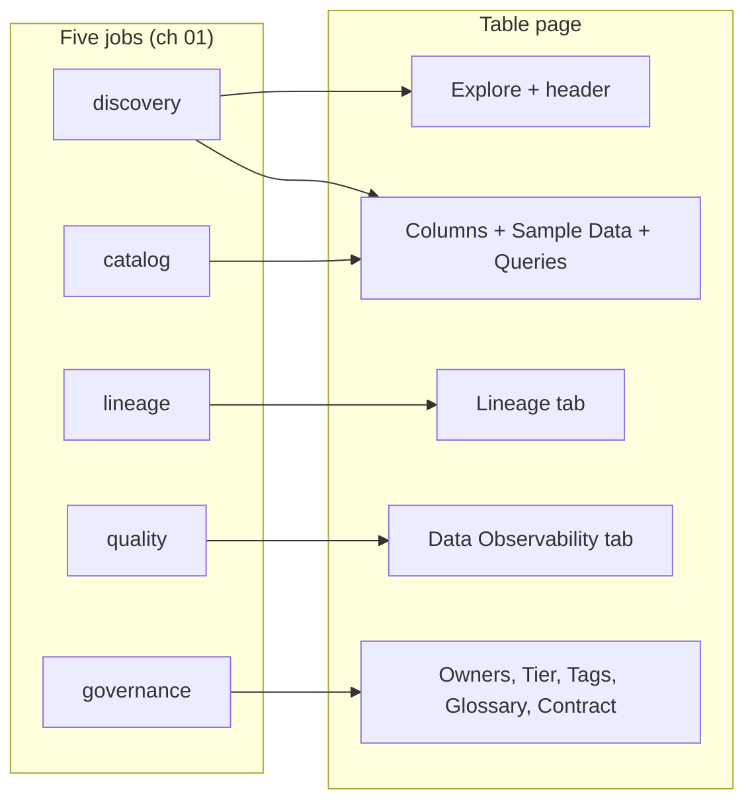
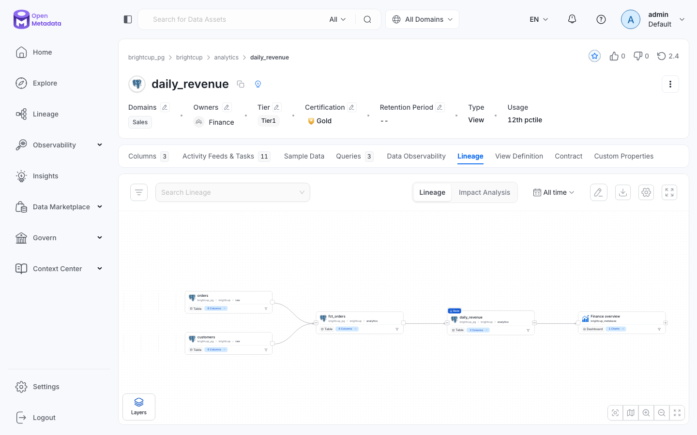
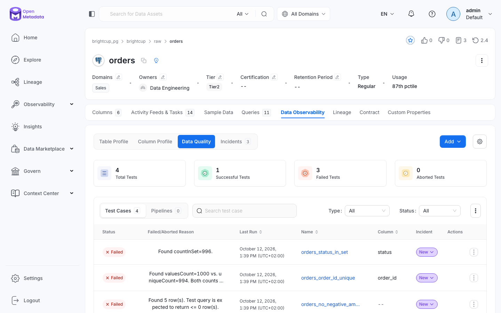
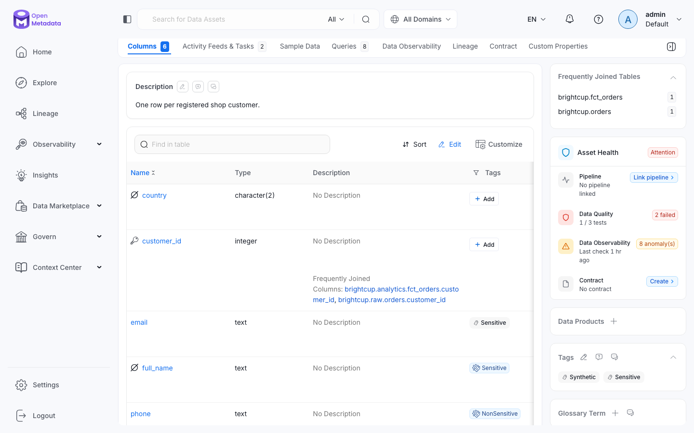
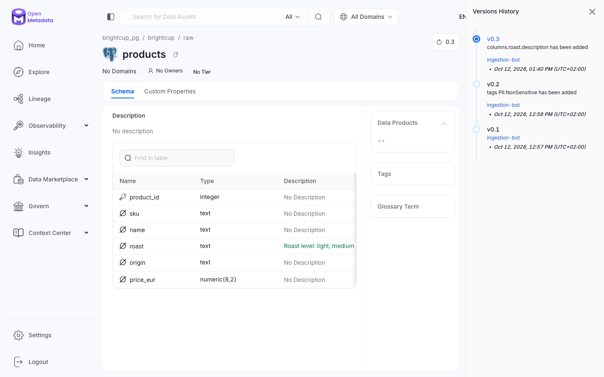
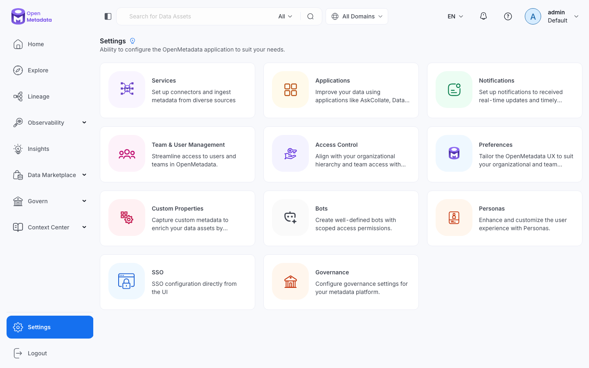

# 02 — A tour of the UI

**What you will learn**
- The layout: the left menu (Home, Explore, Lineage, Observability, Insights, Data Marketplace, Govern, Context Center, Settings), and — on every page but Home — the top search bar and domain switch.
- How to find an asset: searching `revenue` in Explore, reading the result card, and narrowing with facets.
- The table page, the page you will use most: its header, its tabs, and its right panel — and which of the five jobs from chapter 01 each tab serves.
- Where lineage, data quality, and governance (PII tags) appear on a real table, with real screenshots.
- That every edit creates a new, attributed entity version — and which settings live under Settings.

This is Level 1, second half of the [levels tree](plan.md#the-levels-tree). Chapter 01 answered *which problems* OpenMetadata solves; this chapter zooms into the *"people search, read and enrich it"* branch from Level 0 and answers one question: *what does a user see and click, and where does each of the five jobs live in the UI?* Nothing here changes the catalog except one column description (step 5) — everything else is reading.

Log in at http://localhost:18585 as `admin@open-metadata.org` / `admin` (local-only credentials from `index.md`). All screenshots below were taken against the running stack with `just shot <url-path> <out.png>` (real Chromium via Playwright, 1440×900); the ones that need a tab click come from `project/src/openmetadata_tutorial/ch02_screens.py`:

```bash
$ uv run python -m openmetadata_tutorial.ch02_screens
saved .../assets/02_quality_orders.png
saved .../assets/02_customers_pii.png
saved .../assets/02_products_versions.png
saved .../assets/02_lineage_daily_revenue.png
```

## 1. One page: Home

After login you land on `/my-data` (Home):



- **Left menu** — the whole product, top to bottom: `Home` (this landing page), `Explore` (search), `Lineage` (the global lineage graph), `Observability` (tests, profilers, incidents, alerts), `Insights` (KPIs about the catalog itself), `Data Marketplace`, `Govern` (glossaries, classifications, domains, data products), `Context Center` (articles and documents), `Settings` (admin), `Logout`. The ▾ marks mean a submenu.
- **Top bar** — on Home this is minimal: language (`EN`), notifications (bell), help, and your user (`admin`, role `Default`). There is no search box or domain switch here — those appear on the other pages (Explore, the table page), where the bar reads "Search for Data Assets" with a type filter (`All`) and an `All Domains` switch.
- **Middle** — a welcome banner ("Hi admin, Welcome to OpenMetadata!") with a "Take a product tour to get started!" link. On a fresh install the rest of this page is mostly empty; the catalog fills it in as assets gain owners, tiers, and activity.
- **Bottom right** — the server version card (`2.0.5` here). When screenshots in this tutorial disagree with what you see, check this card first: menu and tab names below are 2.0.5's, not older docs'.

What it means for us: there is exactly one place to look for each job — no hidden second UI. The rest of the chapter walks the menu top to bottom on the running example.

## 2. Find it: searching `revenue` in Explore

Our finance dashboard reads `analytics.daily_revenue`. Type `revenue` in the top search bar — you land on Explore (`/explore/tables?search=revenue`):



Three areas, left to right:

1. **Facets (left).** `Browse Estate` groups hits by kind — here Tables 1, Columns 1, Dashboards 1, Charts 1, Glossary Terms 2, Tags 1, Data Products 1 — and the top row filters by Domains, Data Products, Owners, Tag, Tier, Service, Service Type, Database, Schema, Column, Table Type, Column Description. (These counts reflect everything cataloged so far, including entities other chapters add under their own names; on your stack the numbers may differ. The `daily_revenue` hit is what matters.)
2. **Result card (middle).** One hit under Tables: `brightcup_pg › brightcup › analytics › daily_revenue`, badged `Sales · Finance · Tier1 · Usage 12th pctile`. Below it, *why* it matched: "1 in Display Name, 1 in Name". Search covers names, descriptions, and more — not just table names. (The card's description reads "Edited by the ch09 access demo." — chapter 09's access demo rewrites this table's description under its own name; on your stack the text may differ. What matters is that the card shows the current description, owner, and badges.)
3. **Preview (right).** Clicking the hit shows the asset without leaving Explore: Description (who authored it and when), Overview (Type `View`, Queries `3 Queries`, Columns 3, Incidents 0), `Data Quality Tests: 1, Success: 1`, `Lineage — Upstream: 2, Downstream: 1`, Owners `Finance`. Its side tabs (Overview, Schema, Lineage, Data Quality, Custom Property) are shortcuts to the table page's tabs.

What it means for us: discovery is search plus facets, and the result card already answers "is this the right revenue table?" — the description, the owner, and the upstream/downstream counts. Descriptions, tags, and owners are what make results useful; an undescribed table is nearly invisible here. (Some badges — owner `Finance`, `Tier1`, domain `Sales` — are added by later chapters. Ignore them for now; chapter 08 explains each.)

> **Important:** What you see is filtered by the domain switch (`All Domains` at the top).
> **What it means for us:** keep it on `All Domains` in this tutorial; filter only when you know why.
> **Why it matters:** once domains exist (chapter 08), assets seem to "disappear" for anyone who selected a different domain — the asset is still there, the filter is hiding it.

## 3. The table page: one hub per asset

Click through to `analytics.daily_revenue` (`/table/brightcup_pg.brightcup.analytics.daily_revenue`). This page is the hub you will use most — one tab per job:



**Header (top card).** Breadcrumb `brightcup_pg › brightcup › analytics › daily_revenue`, then one badge row: Domains `Sales`, Owners `Finance`, Tier `Tier1`, Certification `Gold`, Retention Period `--`, Type `View`, Usage `12th pctile`. Top right: follow/star, votes, and the **version button** (`2.4` here — step 5 explains it). Each badge is editable (pencil icon); ownership, tier, and certification are governance, covered in chapter 08. The description card below reads "Edited by the ch09 access demo." (authored by `dana.analyst`) — another chapter's edit showing up on our running example; see the note below on live values.

> **Important:** The header numbers are live values, not fixed facts: the version grows with every edit, and Usage/Queries/Activity counts reflect usage ingestion and other chapters' work.
> **What it means for us:** your stack will show different numbers (this shot shows version `2.4`, Usage `12th pctile`, Queries `3`, Activity Feeds & Tasks `11`; the Lineage-tab shot in step 4 shows the same `2.4` / `12th pctile` / `3` because it was taken against the same state).
> **Why it matters:** if two screenshots in this chapter disagree on a version or a count, the catalog moved between shots — the feature is where the number lives, not the number itself.

**Tabs (middle).** Every tab, what it shows, which of chapter 01's five jobs it serves, and where it is deepened:

| tab | what it shows | job | deepened in |
|---|---|---|---|
| Columns | column names, types, descriptions, tags | catalog | ch 01/08 |
| Activity Feeds & Tasks | change feed and open tasks on this asset | catalog | ch 05 (API) |
| Sample Data | a few real rows | discovery | — |
| Queries | queries run against this asset (from usage ingestion) | discovery | ch 04 |
| Data Observability | profiler numbers, quality tests, incidents | quality | ch 07, step 4 below |
| Lineage | upstream sources and downstream consumers | lineage | ch 06, step 4 below |
| View Definition | the SQL behind a view | lineage | ch 06 |
| Contract | the promised schema/quality/SLA, if any | governance | ch 09 |
| Custom Properties | extra fields your team defines | catalog | ch 08 |

**Right panel.** `Asset Health` (`All clear`: Pipeline with no pipeline linked, Data Quality 1/1 tests passing, Data Observability with no anomalies, Contract passing), then `Data Products` (here `Revenue Reporting`, added by chapter 08), `Tags`, and `Glossary Term` — the governance panel from chapter 08.



What it means for us: any question from chapter 01 now has a tab. "Where is revenue data?" → Explore. "What does this column mean?" → Columns. "What breaks if `raw.orders` changes?" → Lineage. "Can I trust `daily_revenue`?" → Data Observability. "Who owns it, is it personal data?" → header and right panel.

## 4. The tabs that matter for the jobs

### Lineage: where `daily_revenue` comes from and where it goes

The Lineage tab (`.../daily_revenue/lineage`) draws the chain as a graph:



Read left to right: `raw.orders` and `raw.customers` feed `analytics.fct_orders`, which feeds `analytics.daily_revenue` (marked `Base` — the asset you came from), which feeds a `Finance overview` dashboard. (That dashboard is added by chapter 06 under its own service; on a stack without it, the chain ends at `daily_revenue`.) Above the canvas: a lineage search, a `Lineage / Impact Analysis` switch (impact mode walks the same graph forward from a planned change), and an `All time` filter. Each node expands to its columns, so column-level tracing starts here too.

What it means for us: the "what breaks if `raw.orders` changes?" question is answered visually — everything downstream-right of `raw.orders` needs re-checking. Chapter 06 shows how these edges are created (view SQL, query logs, API) and how to query them as data.

### Data Observability: can we trust it?

The same tab on `raw.orders` — the raw table `daily_revenue` is built from — tells a different story. Open Data Observability, then its `Data Quality` sub-tab (the tab also holds Table/Column Profile and Incidents):



- **Cards:** 4 Total Tests, 1 Successful, **3 Failed**, 0 Aborted.
- **Rows:** `orders_status_in_set` on `status` — "Found countInSet=996."; `orders_order_id_unique` on `order_id` — "Found valuesCount=1000 vs. uniqueCount=994."; `orders_no_negative_amounts` — "Found 5 row(s). Test query is expected to return <= 0 row(s)." Each has a `New` incident and a last-run timestamp.

What it means for us: these are exactly the defects planted in the shop data (chapter 01 named them, the plan lists them): 4 misspelled `shiped` statuses (996 of 1,000 in the allowed set), 3 duplicated order ids (994 unique of 1,000), 5 negative amounts. The UI shows each failure with its reason, its column, and its incident — this tab is where "can I trust `daily_revenue`?" gets its answer: not yet, and here is precisely why. Chapter 07 defines these tests and adds more.

### Columns: is it personal data?

The Columns tab of `raw.customers` carries the governance answer (scrolled to the tagged rows):



`email` and `full_name` carry `Sensitive`; `phone` carries `NonSensitive` — put there by the auto-classification workflow (chapter 04 runs it, chapter 08 explains classifications). The right panel agrees: table tags `Synthetic` and `Sensitive`, Asset Health `Attention` with Data Quality 1 / 3 tests (2 failed) and 8 anomalies, as the screenshot shows. (Chapter 07 adds more tests to this table, so expect larger counts after running it — what matters here is where sensitivity surfaces.) The `customer_id` row also shows `Frequently Joined Columns` (`fct_orders.customer_id`, `orders.customer_id`) — join hints mined from usage.

What it means for us: sensitivity is visible exactly where an analyst would look before using a column — not in a separate tool. Anyone opening `raw.customers` sees that names and emails are sensitive before copying them anywhere.

## 5. Change something and watch it version

The catalog is read-write: descriptions, owners, tags, and tier are all editable in place (pencil icons, `+ Add` buttons). The one edit in this chapter sets the description of column `raw.products.roast`. The spec allows a UI click or one API call saying which; this chapter uses one JSON Patch call, wrapped in a small idempotent module so anyone can re-run it:

```bash
$ uv run python -m openmetadata_tutorial.ch02_edit
description already set; version is 0.3
version  by              roast description
0.3      ingestion-bot   'Roast level: light, medium or dark.'
0.2      ingestion-bot   ''
0.1      ingestion-bot   ''
```

(First run of the module PATCHed the description (moving the version 0.2 → 0.3); the module patches only when the text differs, so this re-run just reports `description already set`. On a fresh stack your first run shows the `patched ... version is now 0.3` line instead — same call, same result.) The same fact comes straight from the API: `GET /v1/tables/{id}/versions` returns every past snapshot of the entity, newest first. Trimmed with `jq` to the version, who made it, and the `roast` description in each snapshot (run from `project/`, after `source .env` so the token from `.env` is in the shell):

```bash
$ TID=$(curl -s -H "Authorization: Bearer $OM_JWT_TOKEN" "$OM_URL/api/v1/tables/name/brightcup_pg.brightcup.raw.products" | jq -r .id)
$ curl -s -H "Authorization: Bearer $OM_JWT_TOKEN" "$OM_URL/api/v1/tables/$TID/versions" | jq '[.versions[] | fromjson | {version, updatedBy, roast: ([.columns[] | select(.name=="roast") | .description][0])}]'
[
  {
    "version": 0.3,
    "updatedBy": "ingestion-bot",
    "roast": "Roast level: light, medium or dark."
  },
  {
    "version": 0.2,
    "updatedBy": "ingestion-bot",
    "roast": null
  },
  {
    "version": 0.1,
    "updatedBy": "ingestion-bot",
    "roast": null
  }
]
```

Three versions, and only 0.3 carries the new description — the same history the module prints as a table. Edits are attributed to whoever's token made them — `ingestion-bot` here, because the module authenticates with the bot token from `project/.env`. The module's idempotent patch and version-listing logic are covered by `project/tests/test_ch02_edit.py` (`uv run pytest tests/test_ch02_edit.py` — 6 passed).

Click the version button (top right, now `0.3`) to see the same history in the UI:



The drawer lists `v0.3 — columns.roast.description has been added`, `v0.2 — tags PII.NonSensitive has been added`, `v0.1`, each with who and when — and the `roast` row shows the new description highlighted. Nothing is silently overwritten: every change is a new entity version with an author and a timestamp. This is the base of the activity feed and of audit — and the same entity versions chapter 05 reads from the API.

> **Important:** UI edits and ingestion re-runs can fight: a re-run does not overwrite descriptions or owners added in the UI unless `overrideMetadata: true` is set in the workflow.
> **What it means for us:** decide per field where the truth lives — the source comment or the catalog — and set the flag accordingly (defaults keep UI edits).
> **Why it matters:** people lose curated descriptions on the next ingestion run, or wonder why a fixed source comment never shows up. Chapter 04 demonstrates the flag.

## 6. The rest of the menu, briefly

| menu | what lives there | chapter |
|---|---|---|
| Lineage | the global lineage graph across all assets (the same canvas as the tab, any starting point) | ch 06 |
| Observability | profiler runs, test suites and test cases, incidents, alerts | ch 07, 09 |
| Insights | KPIs about the catalog itself (coverage, ownership, test health) | ch 10 |
| Data Marketplace | curated data products for consumers | ch 08 |
| Govern | glossaries, classifications, domains, data products, metrics | ch 08 |
| Context Center | articles and documents (2.0's replacement for Knowledge Center) | ch 10 |
| Settings | everything administrative — one screenshot below | ch 03, 09 |

Settings (`/settings`):



One card per area: `Services` (register source systems and their connectors — chapter 04), `Applications` (bundled apps), `Notifications` (where alerts go — chapter 09), `Team & User Management` and `Access Control` (users, teams, roles, policies — chapter 09), `Preferences`, `Custom Properties`, `Bots` (machine users like `ingestion-bot` — chapter 04), `Personas`, `SSO`, `Governance`. If something in this tutorial says "in Settings", it is one of these cards.

## Key takeaways

- The **table page is the hub**: header (who owns it, how important it is), one tab per job (Columns, Data Observability, Lineage, Contract…), right panel (health, tags, glossary). Learn this page and you know where everything lives.
- Search plus facets is how people **discover**; descriptions, tags, and owners are what make results useful — an undescribed asset is nearly invisible in Explore.
- Every change creates a **new, attributed entity version** — the versions drawer in the UI and `GET /v1/tables/{id}/versions` in the API show the same history. That versioned entity is what chapter 05 reads programmatically.

Next: [03_architecture_and_deployment.md](03_architecture_and_deployment.md) — what runs where: the server, the metadata store, the search index, the ingestion framework, and our Compose stack.
