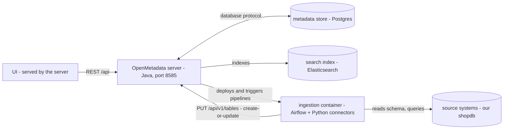
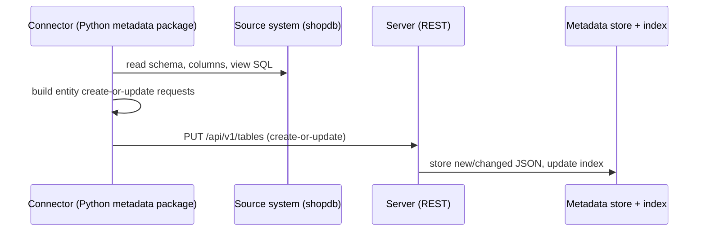

# 03 — Architecture and deployment

**What you will learn**
- The five parts: UI, OpenMetadata server (Java, REST API), metadata store (Postgres), search index (Elasticsearch), ingestion framework (Python `metadata` package) with its scheduler (Airflow, in the ingestion container)
- How entities are stored: JSON Schemas, JSON documents in the metadata store, relationships in a separate table, search documents derived from them
- Two flows: a UI/API request (read + write) and an ingestion run
- Deployment options (Docker Compose, Kubernetes with Helm charts, bare metal, Collate managed SaaS) and what production adds
- How our `docker-compose.yml` maps to all of that, and which settings matter

This is Level 2, first chapter. It zooms into "the server stores it and indexes it" from Level 0 (chapter 00 showed the whole thing running once). Question: *what are the moving parts, how do they talk, and how do you deploy them for real?*

Chapters 00–02 taught the vocabulary this chapter stands on: the stack, the FQN (`brightcup_pg.brightcup.raw.orders`), entity versions, and ingestion runs. Nothing new is assumed beyond that.

All commands below run from `project/` (shell variables like `$OM_URL` and `$OM_JWT_TOKEN` come from `project/.env`, written by `just token`).

## 1. Simple: a picture of the five parts

In everyday words: the browser never talks to the databases directly. It talks to one Java server over REST (plain HTTP calls to URLs that send and receive JSON — the same way any script talks to a web API); that server keeps the truth in Postgres, keeps a searchable copy in Elasticsearch, and receives new metadata from Python connectors that read your source systems. A scheduler runs those connectors on a timetable — here that scheduler is Airflow, a program whose only job is "run this job every night at 2am" (in everyday words: an alarm clock for data jobs).

Precisely, the five parts and their arrows:



Two words in the arrows need a gloss before we go on. The server reaches Postgres over its database protocol (the Java world calls this JDBC — just "the standard way a Java program talks to a database", nothing more). Everything else — browser, connectors, scripts — talks to the server over REST. Two more names appear in this chapter's commands and are explained where they first matter: the JWT bearer token in the `curl` commands below is a signed login token (the ingestion-bot's, written to `.env` by `just token`), and the Fernet key in section 5's settings table is the secret the server uses to encrypt stored source passwords. Nothing else in this chapter needs a new term.

Our `docker-compose.yml` is this picture, running. From `project/`:

```bash
$ docker compose ps -a
NAME                    IMAGE                                                 COMMAND                  SERVICE               CREATED          STATUS                     PORTS
om-tutorial-ingestion   docker.getcollate.io/openmetadata/ingestion:2.0.5     "/bin/bash /opt/airf…"   ingestion             37 minutes ago   Up 36 minutes              0.0.0.0:18080->8080/tcp, [::]:18080->8080/tcp
om-tutorial-metadb      docker.getcollate.io/openmetadata/postgresql:2.0.5    "docker-entrypoint.s…"   postgresql            37 minutes ago   Up 37 minutes (healthy)    0.0.0.0:15432->5432/tcp, [::]:15432->5432/tcp
om-tutorial-migrate     docker.getcollate.io/openmetadata/server:2.0.5        "/bin/bash ./bootstr…"   execute-migrate-all   37 minutes ago   Exited (0) 3 minutes ago
om-tutorial-search      docker.elastic.co/elasticsearch/elasticsearch:9.3.0   "/bin/tini -- /usr/l…"   elasticsearch         37 minutes ago   Up 37 minutes (healthy)    0.0.0.0:19200->9200/tcp, [::]:19200->9200/tcp
om-tutorial-server      docker.getcollate.io/openmetadata/server:2.0.5        "/bin/bash /openmeta…"   openmetadata-server   37 minutes ago   Up 36 minutes (healthy)    0.0.0.0:18585->8585/tcp, [::]:18585->8585/tcp, 0.0.0.0:18586->8586/tcp, [::]:18586->8586/tcp
om-tutorial-shopdb      postgres:17                                           "docker-entrypoint.s…"   shopdb                5 minutes ago    Up 5 minutes (healthy)     0.0.0.0:15433->5432/tcp, [::]:15433->5432/tcp
om-tutorial-webhook     python:3.12-slim                                      "python -m openmetad…"   webhook               37 minutes ago   Up 37 minutes              0.0.0.0:18090->8000/tcp, [::]:18090->8000/tcp
```

Each box in the diagram maps to one row: `openmetadata-server` is the server (host ports 18585 for UI/API, 18586 for admin), `postgresql` is the metadata store (host 15432), `elasticsearch` is the search index (host 19200), `ingestion` is Airflow plus the Python `metadata` package (host 18080). `shopdb` and `webhook` are tutorial extras, not OpenMetadata parts: the source database we catalog (a plain `postgres:17` image — the container was recreated since the stack first came up, hence the younger age), and the alert receiver chapter 09 uses.

One row needs explaining: `om-tutorial-migrate` (`execute-migrate-all`) ran once and exited with code 0. It runs `./bootstrap/openmetadata-ops.sh migrate` — the database migrations — before the server starts. In plain words: the server's tables are created and altered by versioned migration scripts, not by hand. This is also how upgrades work (section 5): new server image, run migrations, then start.

Server version, for the record:

```bash
$ just api /v1/system/version
{
  "version": "2.0.5",
  "revision": "c96845e6131c934dc993d9d3e8bae020365f09a7",
  "timestamp": 1791545997420
}
```

That tells us the whole chapter describes OpenMetadata 2.0.5.

## 2. Medium: follow one entity through the parts — `raw.orders`

An **entity** is any typed thing the server stores — a table, a user, a tag, a test case — with an `id`, a `name`, a `fullyQualifiedName` (FQN), and a `version`. Underneath, every entity type is defined as a JSON Schema (see the architecture doc at `https://docs.open-metadata.org/v2.0.x/developers/architecture`); the server stores each entity as one JSON document. We follow `brightcup_pg.brightcup.raw.orders` through all three keeps: the API, the store, the index.

### 2a. The server: one REST door

```bash
$ curl -s -H "Authorization: Bearer $OM_JWT_TOKEN" "$OM_URL/api/v1/tables/name/brightcup_pg.brightcup.raw.orders" | jq '{id, name, fullyQualifiedName, version, updatedAt, columns: (.columns | length)}'
{
  "id": "463468b2-da6c-4c6e-a527-28a4c56f6436",
  "name": "orders",
  "fullyQualifiedName": "brightcup_pg.brightcup.raw.orders",
  "version": 0.7,
  "updatedAt": 1791804799861,
  "columns": 6
}
```

Six columns, version 0.7 — this matches the shop schema (`order_id`, `customer_id`, `order_ts`, `status`, `total_amount`, `currency`). The version number moves as chapters enrich the same table (owners, descriptions, tags from parallel chapters each land here), so do not expect it to stand still between runs. The interpretation for us: every UI page and every script goes through this same REST door; the `version` here (0.7) is the number the store also holds (next step), so API, UI and database agree.

### 2b. The metadata store: one JSON document per entity

The server's own Postgres lives at host port 15432. The per-entity tables are named after the entity: `table_entity` holds tables, and `entity_relationship` holds the links between entities:

```bash
$ docker exec om-tutorial-metadb psql -U postgres -d openmetadata_db -c '\dt' | grep -iE 'table_entity|entity_rel'
 public | entity_relationship                     | table             | openmetadata_user
 public | table_entity                            | table             | openmetadata_user
```

The row for our table:

```bash
$ docker exec om-tutorial-metadb psql -U postgres -d openmetadata_db -c "SELECT json->>'name' AS name, json->>'fullyQualifiedName' AS fqn, json->>'version' AS version FROM table_entity WHERE json->>'fullyQualifiedName' = 'brightcup_pg.brightcup.raw.orders';"
  name  |                fqn                | version
--------+-----------------------------------+---------
 orders | brightcup_pg.brightcup.raw.orders | 0.7
(1 row)
```

Version 0.7 in the store matches version 0.7 from the API — the API is a thin view over this JSON. One column of that JSON, trimmed:

```bash
$ docker exec om-tutorial-metadb psql -U postgres -d openmetadata_db -c "SELECT jsonb_pretty((json->'columns'->0) - 'description') FROM table_entity WHERE json->>'fullyQualifiedName' = 'brightcup_pg.brightcup.raw.orders';"
                              jsonb_pretty
------------------------------------------------------------------------
 {
     "name": "order_id",
     "children": [
     ],
     "dataType": "INT",
     "constraint": "NOT_NULL",
     "dataLength": 1,
     "dataTypeDisplay": "integer",
     "fullyQualifiedName": "brightcup_pg.brightcup.raw.orders.order_id"
 }
(1 row)
```

So an entity is literally one JSON document in one row. Relationships — "schema contains table", "table has owner", "table A is upstream of table B" — are *not* inside that JSON; they are rows in `entity_relationship`. Note the column names are all lowercase (`fromid`, `toid`, `fromentity`, `toentity`, `relation` — not camelCase). Every row touching our table:

```bash
$ docker exec om-tutorial-metadb psql -U postgres -d openmetadata_db -c "SELECT fromentity AS from_entity, toentity AS to_entity, relation, deleted FROM entity_relationship WHERE fromid='463468b2-da6c-4c6e-a527-28a4c56f6436' OR toid='463468b2-da6c-4c6e-a527-28a4c56f6436' ORDER BY fromentity, toentity;"
  from_entity   | to_entity | relation | deleted
----------------+-----------+----------+---------
 databaseSchema | table     |        0 | f
 domain         | table     |       10 | f
 table          | table     |       13 | f
 table          | table     |       13 | f
 table          | testSuite |        0 | f
 team           | table     |        8 | f
(6 rows)
```

Read it as a sentence per row: the `raw` schema contains this table (relation 0); a domain and a team point at it (10, 8); it feeds two downstream tables via view lineage (13, 13 — including the `ch06_dynamic` view chapter 06 added on this same shared stack); and it owns a test suite (0). That split is deliberate: the document describes the thing, the relationship table describes the graph, so lineage queries never parse JSON.

> **Important:** the metadata store is the source of truth; the search index is derived.
> **What it means for us:** back up the Postgres database; the Elasticsearch index can be rebuilt from it.
> **Why it matters:** backing up only Elasticsearch loses everything — it is a copy, not the original.

### 2c. The search index: a derived copy for search

```bash
$ curl -s 'localhost:19200/_cat/indices/table_search_index?v'
health status index              uuid                   pri rep docs.count docs.deleted store.size pri.store.size dataset.size
yellow open   table_search_index q3coa_qJS2S0gH-T9CpsSg   1   1         11             2    782.4kb        782.4kb      782.4kb
```

There is one index per entity family (`table_search_index`, `column_search_index`, `glossary` indexes, and so on). But `docs.count` here is 11 while the catalog holds 8 tables — so `docs.count` is *not* the table count. Treat both `docs.count` and `docs.deleted` as moving snapshots, not fixed facts: re-running the same command minutes later showed 10 and 4, and an earlier run showed 11 and 17. The honest count comes from `_count` and the API, which agree:

```bash
$ curl -s 'localhost:19200/table_search_index/_count'
{"count":8,"_shards":{"total":1,"successful":1,"skipped":0,"failed":0}}
$ curl -s -H "Authorization: Bearer $OM_JWT_TOKEN" "$OM_URL/api/v1/tables?limit=1" | python3 -c "import json,sys; print(json.load(sys.stdin)['paging'])"
{'after': 'eyJuYW1lIjoiY2gwNl9keW5hbWljIiwiaWQiOiI4ZGZmYWVmOS1mNTlkLTQyZDUtODRjZi1iMDhlNTcxZTQ1YWEifQ==', 'total': 8}
```

8 search documents, 8 tables via the API (7 from the Brightcup seed plus the `ch06_dynamic` view chapter 06 added on this shared stack). Why does `_cat` say 11? Its `docs.count` counts Lucene-level documents, not entities. Lucene is the search library inside Elasticsearch that stores the actual index data: one search document occupies one Lucene document *plus* one extra Lucene document per `nested`-typed sub-object it carries. That this index has such sub-objects is checkable in its mapping:

```bash
$ curl -s 'localhost:19200/table_search_index/_mapping' | python3 -c "import json,sys; m=json.load(sys.stdin)['table_search_index']['mappings']['properties']; print('nested-typed fields:', [k for k,v in m.items() if v.get('type')=='nested'], '| columns.children nested:', [k for k,v in m['columns']['properties'].items() if v.get('type')=='nested'])"
nested-typed fields: ['customPropertiesTyped', 'owners'] | columns.children nested: ['customPropertiesTyped']
```

So the 3 extra Lucene documents are the nested `owners` / custom-property sub-objects spread across the 8 search documents, and `docs.deleted` (2 on this sample) counts stale document versions not yet merged away — neither equals entities. The interpretation for us: never read entity counts off `_cat`; use `_count` or the API's paging total.

Searching it directly:

```bash
$ curl -s 'localhost:19200/table_search_index/_search?q=name:orders&size=2' | jq '.hits.hits[]._source | {name, fullyQualifiedName, entityType}'
{
  "name": "orders",
  "fullyQualifiedName": "brightcup_pg.brightcup.raw.orders",
  "entityType": "table"
}
{
  "name": "fct_orders",
  "fullyQualifiedName": "brightcup_pg.brightcup.analytics.fct_orders",
  "entityType": "table"
}
```

A search for `orders` finds both `raw.orders` and the `fct_orders` view built from it — that is the index doing its job: fast text search over derived documents. The interpretation for us: the UI's Explore page reads from here, not from Postgres. If this index were deleted, no metadata would be lost — the `SearchIndexingApplication` rebuilds it from the store:

```bash
$ curl -s -H "Authorization: Bearer $OM_JWT_TOKEN" "$OM_URL/api/v1/apps/name/SearchIndexingApplication" | jq '{name, appType, scheduleType}'
{
  "name": "SearchIndexingApplication",
  "appType": "internal",
  "scheduleType": "ScheduledOrManual"
}
```

It exists and is a scheduled-or-manual internal app — reindexing is a supported operation, not a hack.

## 3. Medium: the two flows

### 3a. A user edits a description

```mermaid
sequenceDiagram
    participant U as UI (browser)
    participant S as Server (REST)
    participant D as Metadata store (Postgres)
    participant I as Search index (Elasticsearch)
    participant E as Events (activity feed / alerts)
    U->>S: PATCH /api/v1/tables/id (new description)
    S->>D: write new JSON, bump updatedAt
    S->>I: update search document
    S->>E: emit change event
    E-->>U: activity feed entry; alert fires if subscribed
```

One new thing here versus everything before: a *write* lands first in the store and then fans out to two places (index + events). This was actually run, not just drawn — a PATCH adding a probe suffix to the description of `raw.orders`:

```bash
$ TID=463468b2-da6c-4c6e-a527-28a4c56f6436
$ curl -s -X PATCH -H "Authorization: Bearer $OM_JWT_TOKEN" -H 'Content-Type: application/json-patch+json' "$OM_URL/api/v1/tables/$TID" -d '[{"op":"replace","path":"/description","value":"One row per web-shop order. (ch03 architecture probe.)"}]' | jq '{version, updatedAt, description}'
{
  "version": 0.5,
  "updatedAt": 1791804248795,
  "description": "One row per web-shop order. (ch03 architecture probe.)"
}
$ curl -s -H "Authorization: Bearer $OM_JWT_TOKEN" "$OM_URL/api/v1/tables/name/brightcup_pg.brightcup.raw.orders" | jq '{version, description}'
{
  "version": 0.5,
  "description": "One row per web-shop order. (ch03 architecture probe.)"
}
```

The FQN read shows the new text immediately — it comes from the store, not the index. The search document caught up within seconds:

```bash
$ curl -s 'localhost:19200/table_search_index/_search?q=fullyQualifiedName:brightcup_pg.brightcup.raw.orders&size=1' | python3 -c "import json,sys; d=json.load(sys.stdin); print(d['hits']['hits'][0]['_source'].get('description'))"
One row per web-shop order. (ch03 architecture probe.)
```

(The probe text was reverted right after: description back to `One row per web-shop order.`, so other chapters see the table as they left it.) Two things to carry from this: the version number did *not* move for this description edit (0.5 before and after — only `updatedAt` changed), while the 0.7 in sections 2a–2b comes from other kinds of changes landing in parallel; and the limit to know is about *search*, not FQN reads — a search a millisecond after an edit can still show the old text, but fetching by FQN never lags because it reads through the server from the store.

### 3b. An ingestion run



Evidence that "create-or-update" really means *update only when something changed*: the entity's version before and after a full re-run of the metadata workflow. Version first:

```bash
$ curl -s -H "Authorization: Bearer $OM_JWT_TOKEN" "$OM_URL/api/v1/tables/name/brightcup_pg.brightcup.raw.orders" | jq '{version, updatedAt}'
{
  "version": 0.7,
  "updatedAt": 1791804370830
}
```

Then the re-run itself (long per-table lines cut with `...`; the summary lines below are pasted exactly as printed):

```bash
$ uv run python -m openmetadata_tutorial.ingest ingest ingestion/metadata.yaml
...
[2026-10-12 11:26:16] INFO     {metadata.Utils:logger:223} - Processed records: 11
[2026-10-12 11:26:16] INFO     {metadata.Utils:logger:223} - Updated records: 0
[2026-10-12 11:26:16] INFO     {metadata.Utils:logger:223} - Success %: 100.0
[2026-10-12 11:26:16] INFO     {metadata.Utils:logger:223} - Processed records: 12
[2026-10-12 11:26:16] INFO     {metadata.Utils:logger:223} - Updated records: 0
[2026-10-12 11:26:16] INFO     {metadata.Utils:logger:223} - Success %: 100.0
[2026-10-12 11:26:16] INFO     {metadata.Utils:logger:223} - Workflow Success %: 100.0
[2026-10-12 11:26:16] INFO     {metadata.Utils:logger:223} - Workflow finished in time: 703.240ms
```

There are two Processed/Updated blocks because the run has two stages (11 source records, then 12 sink records) — both report `Updated records: 0`. And after:

```bash
$ curl -s -H "Authorization: Bearer $OM_JWT_TOKEN" "$OM_URL/api/v1/tables/name/brightcup_pg.brightcup.raw.orders" | jq '{version, updatedAt}'
{
  "version": 0.7,
  "updatedAt": 1791804370830
}
```

Same version, same `updatedAt`, down to the millisecond. The interpretation for us: re-running ingestion is safe and idempotent — nothing changed in the source, so nothing changed in the catalog, and the version proves it. Chapter 04 builds on exactly this workflow file.

## 4. Complex: what breaks when a part is down

We do **not** stop any shared container to test this. We check the health endpoints, and reason about the consequences from the architecture:

```bash
$ curl -s localhost:18586/healthcheck
{"OpenMetadataServerHealthCheck":{"healthy":true,"duration":0,"timestamp":"2026-10-12T11:23:52.362Z"},"database":{"healthy":true,"duration":0,"timestamp":"2026-10-12T11:23:52.363Z"},"deadlocks":{"healthy":true,"duration":0,"timestamp":"2026-10-12T11:23:52.363Z"}}
$ curl -s localhost:19200/_cluster/health | python3 -c "import json,sys; d=json.load(sys.stdin); print(d['cluster_name'], d['status'])"
docker-cluster yellow
$ curl -s localhost:18080/api/v2/monitor/health | python3 -c "import json,sys; d=json.load(sys.stdin); print({k:(v if not isinstance(v,dict) else v.get('status')) for k,v in d.items() if k in ('metadatabase','scheduler','dag_processor')})"
{'metadatabase': 'healthy', 'scheduler': 'healthy', 'dag_processor': 'healthy'}
```

All three doors answer: the server (plus its own database check), the search cluster (`yellow` is normal for a single-node Elasticsearch — one replica can never be assigned), and Airflow. Note the last command filters the Airflow response down to three keys for readability — the raw response additionally contains a `triggerer` entry with `"status": null` (no triggerer runs in this setup), which the filter hides. The interpretation for us: right now every part is up, so the table below describes *what would happen*, not what is happening.

| Part down | Symptom |
|---|---|
| Metadata store (Postgres) | Everything down: the server's own health check reports unhealthy, UI and API stop. This is the one part with no fallback. |
| Search index (Elasticsearch) | UI search and Explore return empty; entity pages still load when opened directly by FQN, because those read through the server from the store. Reindex via `SearchIndexingApplication` after recovery. |
| Ingestion scheduler (Airflow) | UI-created and UI-scheduled pipelines do not run. CLI runs (`just ingest ...`, chapter 04) still work — they never touch Airflow. |
| OpenMetadata server | UI and API both down (the UI is served by the server); the store and index are fine but unreachable except with direct database/HTTP access. |
| A source system (e.g. shopdb) | Only freshness suffers: the catalog keeps serving the last ingested metadata; new ingestion runs fail until the source returns. |

> **Important:** Airflow is only the scheduler for UI-created pipelines; any scheduler can run the `metadata` CLI.
> **What it means for us:** teams that already run an orchestrator do not need a second Airflow — cron, their own Airflow, or GitHub Actions can run the same commands.
> **Why it matters:** running an Airflow you do not need is the most common over-deployment of this stack. Chapter 04 shows both ways: CLI runs and UI-scheduled pipelines.

## 5. Deployment and config

Who operates what, and at what effort:

| Option | Who it is for | What you operate | HA | Effort |
|---|---|---|---|---|
| Docker Compose | Local evaluation, this tutorial | All containers on one host | None (single host) | Minutes; see `https://docs.open-metadata.org/latest/deployment/docker` |
| Kubernetes + Helm (`openmetadata` and `openmetadata-dependencies` charts) | Team and production self-hosted | Server deployment, external DB/search, Airflow or native K8s jobs | Yes, with replicas and managed dependencies | Days; see `https://docs.open-metadata.org/latest/deployment/kubernetes` |
| Bare metal (JAR + dependencies) | Restricted environments without containers | JVM, DB, search, scheduler by hand | You build it | Highest; same parts, no container help |
| Collate managed SaaS | Teams that want no operations | Nothing (connectors still run near your data) | Vendor-provided | Lowest; the server is hosted for you |

Production adds the same five parts, hardened: an external managed database and search (RDS/Cloud SQL, Elastic Cloud or AWS OpenSearch) instead of containers on one host, SSO instead of basic auth, TLS, backups of the store, and migrations on every upgrade. Sizing guidance below is quoted from the official minimum-requirements page (`https://docs.open-metadata.org/v2.0.x/deployment/minimum-requirements`, checked 2026-10-12): 4 vCPU / 16 GiB / 100 GB+ for the database, 2 vCPU / 8 GiB / 100 GiB per search node (at least 1 master + 2 workers), 4 vCPU / 16 GiB / 100 GiB for Airflow. Our compose is far smaller than any of that — measured right now:

```bash
$ docker stats --no-stream --format 'table {{.Name}}\t{{.CPUPerc}}\t{{.MemUsage}}\t{{.MemPerc}}' | grep -E 'NAME|om-tutorial'
NAME                          CPU %     MEM USAGE / LIMIT     MEM %
om-tutorial-ingestion         3.96%     1.743GiB / 41.07GiB   4.24%
om-tutorial-server            34.92%    1.107GiB / 41.07GiB   2.69%
om-tutorial-shopdb            0.03%     40.34MiB / 41.07GiB   0.10%
om-tutorial-webhook           0.01%     14.83MiB / 41.07GiB   0.04%
om-tutorial-metadb            2.40%     173.6MiB / 41.07GiB   0.41%
om-tutorial-search            0.63%     2.121GiB / 41.07GiB   5.17%
```

About 5.2 GiB in use across the six tutorial containers (Docker on this machine has 41.07 GiB) — consistent with the plan's "~6 GB RAM for Docker" guidance, and fine for 8 tables, but not a sizing target.

The settings that matter, read from our own compose file (real lines from `docker compose config`):

```bash
$ docker compose config | grep -E 'AUTHENTICATION_PROVIDER|AUTHORIZER_ADMIN_PRINCIPALS|DB_HOST|ELASTICSEARCH_HOST|SEARCH_TYPE|PIPELINE_SERVICE_CLIENT_ENDPOINT|SERVER_HOST_API_URL|OPENMETADATA_HEAP_OPTS|FERNET_KEY|JWT_' | sort -u
      AUTHENTICATION_JWT_PRINCIPAL_CLAIMS_MAPPING: '[]'
      AUTHENTICATION_JWT_PRINCIPAL_CLAIMS: '[email,preferred_username,sub]'
      AUTHENTICATION_PROVIDER: basic
      AUTHORIZER_ADMIN_PRINCIPALS: '[admin]'
      CUSTOM_OIDC_AUTHENTICATION_PROVIDER_NAME: '""'
      DB_HOST: postgresql
      ELASTICSEARCH_HOST: ' elasticsearch'
      FERNET_KEY: jJ/9sz0g0OHxsfxOoSfdFdmk3ysNmPRnH3TUAbz3IHA=
      JWT_ISSUER: '"open-metadata.org"'
      JWT_KEY_ID: '"Gb389a-9f76-gdjs-a92j-0242bk94356"'
      OPENMETADATA_HEAP_OPTS: -Xmx1G -Xms1G
      PIPELINE_SERVICE_CLIENT_ENDPOINT: http://ingestion:8080
      SEARCH_TYPE: ' "elasticsearch"'
      SERVER_HOST_API_URL: http://openmetadata-server:8585/api
```

| Setting | Our value | Production value |
|---|---|---|
| `AUTHENTICATION_PROVIDER` | `basic` (login `admin`/`admin`) | SSO (`google`, `okta`, `azure`, …) — basic auth is for local use only |
| `AUTHORIZER_ADMIN_PRINCIPALS` | `[admin]` | Your real admin principals |
| `DB_HOST` / `ELASTICSEARCH_HOST` | In-compose services (`postgresql`, `elasticsearch`) | Managed endpoints (RDS, Elastic Cloud); `SEARCH_TYPE` `elasticsearch` or `opensearch` |
| `PIPELINE_SERVICE_CLIENT_ENDPOINT` | `http://ingestion:8080` | Your Airflow URL, or K8s-native pipeline client |
| `SERVER_HOST_API_URL` | `http://openmetadata-server:8585/api` | The public URL ingestion uses to call back |
| `OPENMETADATA_HEAP_OPTS` | `-Xmx1G -Xms1G` | Sized to the host (more for large catalogs) |
| `FERNET_KEY` | The public default shown above | A fresh random key, kept secret — it encrypts stored source passwords |
| `JWT_ISSUER` / `JWT_KEY_ID` (plus the RSA key pair) | The public defaults shown above | Freshly generated — they sign auth tokens |

> **Important:** change the defaults before exposing the server: the `admin`/`admin` login, basic auth, the default JWT keys and the default `FERNET_KEY`.
> **What it means for us:** locally the defaults are convenient; on any networked host they must all be replaced.
> **Why it matters:** anyone who reaches the server with default keys can mint tokens and decrypt the stored source passwords.

## 6. Upgrades: same version, backup, migrate, reindex

Images are versioned together: `server:2.0.5`, `ingestion:2.0.5`, and the `postgresql:2.0.5` metadata image, plus the migrate step that runs from the server image. The order is: back up the metadata store, pull the new images, run the migrations (our `execute-migrate-all` container), start the server, then reindex search if the release notes say so. The 2.0 release notes list breaking changes that prove the rule — for example the embedding configuration moving to a new `llmConfiguration.embeddings` block and the profiler default switching to dynamic sampling — so read the release notes before every upgrade (`https://github.com/open-metadata/OpenMetadata/releases/tag/2.0.0-release`; the 2.0.5 notes at `.../tag/2.0.5-release` cover only maintenance fixes on top).

> **Important:** server, ingestion and migrations upgrade together, same version.
> **What it means for us:** never mix e.g. server 2.0.5 with an older ingestion image.
> **Why it matters:** the ingestion client must equal the server version, or schema mismatches fail ingestion runs at random-looking places.

## Carry forward

- Five parts — **UI, server, metadata store, search index, ingestion plus scheduler** — and the server is the only door (REST).
- Entities are **JSON documents with versions, relationships stored separately**; the search index is a rebuildable copy.
- Production is the same parts with a managed database and search, SSO, fresh secrets, and migrations on every upgrade.
