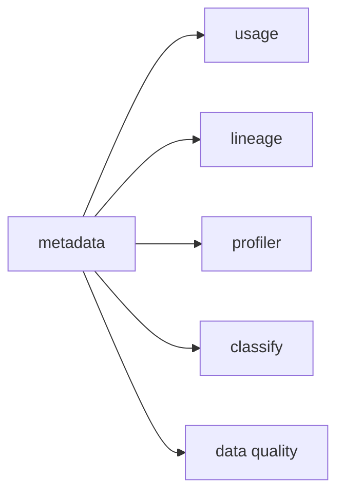

# 04 — Connectors and ingestion

**What you will learn**
- Services and connectors (about a hundred connectors: databases, dashboards, pipelines, messaging, ML models, storage, search, APIs) and what each service type yields
- The workflow YAML anatomy, field by field, and the six workflow types (metadata, usage, lineage, profiler, data quality, auto classification), with the order they must run in
- Filter patterns (regex includes/excludes on database/schema/table)
- What a re-run does: idempotent create-or-update; new tables appear; dropped tables are soft-deleted (`markDeletedTables`); UI edits survive unless `overrideMetadata`
- Two ways to run: the `metadata` CLI (what we have used) vs an ingestion pipeline stored in OpenMetadata and scheduled on Airflow

This is Level 2, second chapter. It zooms into "a connector reads metadata" from Level 0 (chapter 00 showed the whole thing running once; chapter 03 showed where the metadata lands). Question: *how exactly does metadata get in, what can you control, and how do you run it on a schedule?*

It builds on 00–03: the YAML seen once, `just ingest`, and the architecture (ingestion container with Airflow, the store). Nothing else is assumed.

All commands below run from `project/` (shell variables like `$OM_URL` and `$OM_JWT_TOKEN` come from `project/.env`, written by `just token`).

## 1. Simple: read the YAML we already ran

In everyday words: a connector is the code that knows how to read one kind of system (Postgres, Snowflake, Looker, Kafka…), and a **service** is one registered system of that kind — our shop database is registered as the database service `brightcup_pg`. An **ingestion workflow** is one run of a connector job, defined by a YAML file: *where to connect* → *what to read* → *where to send it*. We have been running these since chapter 00 without reading one. Here is `ingestion/metadata.yaml`, the file behind `just ingest metadata`, block by block:

```yaml
source:
  type: postgres            # the connector: which kind of system to read
  serviceName: brightcup_pg # the service: which registered system (created on first run)
  serviceConnection:
    config:
      type: Postgres
      username: ${SHOP_READER_USER}       # om_reader, read-only
      authType:
        password: ${SHOP_READER_PASSWORD}
      hostPort: shopdb:5432  # the shop database as seen inside Docker
      database: brightcup
```

`source.type` names the connector; `serviceName` names the service the results belong to. `serviceConnection` holds the credentials and address. The `${...}` placeholders are filled from `.env` when the run starts, so secrets never land in a file in the repo.

```yaml
  sourceConfig:
    config:
      type: DatabaseMetadata   # the workflow type: what to read
      includeTables: true
      includeViews: true
      markDeletedTables: true  # soft-delete entities whose source table is gone
      schemaFilterPattern:
        includes:
          - ^raw$
          - ^analytics$        # only these schemas; everything else is skipped
```

`sourceConfig` says *what* to read and how: the workflow type (`DatabaseMetadata`), which object kinds to include, what to do with vanished tables, and **filter patterns** — regex includes/excludes applied to database, schema and table names. Here only `raw` and `analytics` are ingested.

```yaml
sink:
  type: metadata-rest   # where to send it: the OpenMetadata REST API
  config: {}
workflowConfig:
  loggerLevel: INFO
  openMetadataServerConfig:
    hostPort: http://openmetadata-server:8585/api  # the server as seen inside Docker
    authProvider: openmetadata
    securityConfig:
      jwtToken: ${OM_JWT_TOKEN}   # the ingestion-bot token from `just token`
```

`sink` is almost always `metadata-rest` — "send create-or-update requests to the server". `workflowConfig` says how to reach the server and which token to present. So the whole anatomy is: **source (+ connection) → what to read (sourceConfig) → sink**, plus server address and token. The two metadata YAMLs (`metadata.yaml` above, `ch04_sandbox.yaml` below) and `lineage.yaml` have exactly these four blocks. The workflows that *compute* something add a fifth block between source and sink — a **processor**, in plain words the step that transforms what the source read before the sink sends it (`orm-profiler` computes statistics for the profiler and classification workflows, `orm-test-runner` runs test cases for data quality, `query-parser` parses sampled SQL for usage). The usage workflow adds two more blocks after it — a **stage** and a **bulkSink** — which section 6 explains one at a time.

We ran five shared YAMLs in chapter 01 (`just bootstrap`), each a different workflow type on the same service. Plus a sixth type, usage, which bootstrap skips. One table for all six:

| YAML | `source.type` | `sourceConfig.type` | CLI command | what it writes |
|---|---|---|---|---|
| `metadata.yaml` | `postgres` | `DatabaseMetadata` | `ingest` | service, database, schemas, tables, views, columns, comments |
| `lineage.yaml` | `postgres-lineage` | `DatabaseLineage` | `ingest` | table and column lineage edges (view SQL + query log) |
| `profiler.yaml` | `postgres` | `Profiler` | `profile` | row counts, nulls, distincts, min/max per table and column |
| `classify.yaml` | `postgres` | `AutoClassification` | `classify` | automatic PII tags on columns |
| `quality.yaml` | `TestSuite` | `TestSuite` | `test` | test-case results on `raw.orders` |
| `ch04_usage.yaml` (this chapter) | `postgres-usage` | `DatabaseUsage` | `usage` | usage counts and query samples on existing tables |

The commands in the third column are the `metadata` CLI subcommands: `just ingest <name>` runs `metadata ingest`, `just ingest profiler profile` runs `metadata profile`, and so on (`ingest`, `usage`, `profile`, `test`, `classify`).

They must run in a fixed order in one sense only: metadata first — it creates the table entities, and every other workflow attaches its output to those entities:



Usage and lineage need the entities (and the query log) to attach to; profiler, classification and quality need the entities too. Beyond "metadata first", the usual tail order — profiler, then classify, then quality — is convention, not a dependency: `classify.yaml` carries its own `processor: orm-profiler` and samples column values itself, independent of any profiler run:

```yaml
  sourceConfig:
    config:
      type: AutoClassification
      storeSampleData: true
      enableAutoClassification: true
      confidence: 80
      ...
processor:
  type: orm-profiler
  config: {}
```

(From `ingestion/classify.yaml`.) Data-quality tests likewise query the database directly; they do not read the profiler's results. Running the profiler before quality is still the useful habit, because a failing test is much easier to interpret against fresh statistics (chapter 07 does exactly that). In short: **metadata first, then the rest in any order; profiler before quality is the useful habit**.

> **Important:** profiler, quality and lineage need entities from a metadata run first.
> **What it means for us:** always run metadata ingestion before anything else on a new service.
> **Why it matters:** later workflows silently do nothing or fail on missing FQNs — an empty quality result usually means "no tables yet", not "all tests pass".

## 2. Medium: a separate playground

Reading one YAML is the concept; now the mechanism, one new thing per step, on a playground that cannot disturb the running example. We create a schema `sandbox` in the same shop database with one small table, and a **new service** `brightcup_sandbox` that reads only that schema — service `brightcup_pg` is never touched:

```bash
$ docker exec -i om-tutorial-shopdb psql -U shop_admin -d brightcup -c "CREATE SCHEMA IF NOT EXISTS sandbox; DROP TABLE IF EXISTS sandbox.promotions; DROP TABLE IF EXISTS sandbox.old_coupons; CREATE TABLE sandbox.promotions(promo_code text, discount_pct int, valid_until date); COMMENT ON TABLE sandbox.promotions IS 'Autumn promo codes for the Brightcup shop.'; INSERT INTO sandbox.promotions VALUES ('AUTUMN10',10,'2026-10-31'),('BEAN20',20,'2026-11-30'),('FREESHIP',0,'2026-12-31'); GRANT USAGE ON SCHEMA sandbox TO om_reader; GRANT SELECT ON ALL TABLES IN SCHEMA sandbox TO om_reader; ALTER DEFAULT PRIVILEGES IN SCHEMA sandbox GRANT SELECT ON TABLES TO om_reader; TABLE sandbox.promotions;"
CREATE SCHEMA
...
 promo_code | discount_pct | valid_until
------------+--------------+-------------
 AUTUMN10   |           10 | 2026-10-31
 BEAN20     |           20 | 2026-11-30
 FREESHIP   |            0 | 2026-12-31
(3 rows)
```

Three rows, three columns, one `COMMENT`, and `SELECT` granted to the read-only ingestion user `om_reader`. The workflow `ingestion/ch04_sandbox.yaml` is the same four blocks as `metadata.yaml`, with a different service name and a filter that only lets `sandbox` through:

```yaml
source:
  type: postgres
  serviceName: brightcup_sandbox
  ...
  sourceConfig:
    config:
      type: DatabaseMetadata
      includeTables: true
      includeViews: true
      markDeletedTables: true
      schemaFilterPattern:
        includes:
          - ^sandbox$
```

### (a) Filter patterns: only `sandbox` is read

```bash
$ just ingest ch04_sandbox
...
[2026-10-12 12:09:55] INFO     {metadata.Utils:logger:223} - Workflow Postgres Summary:
[2026-10-12 12:09:55] INFO     {metadata.Utils:logger:223} - Processed records: 3
[2026-10-12 12:09:55] INFO     {metadata.Utils:logger:223} - Updated records: 0
[2026-10-12 12:09:55] INFO     {metadata.Utils:logger:223} - Filtered: 4
[2026-10-12 12:09:55] INFO     {metadata.Utils:logger:223} - Success %: 100.0
[2026-10-12 12:09:55] INFO     {metadata.Utils:logger:223} - Workflow OpenMetadata Summary:
[2026-10-12 12:09:55] INFO     {metadata.Utils:logger:223} - Processed records: 4
[2026-10-12 12:09:55] INFO     {metadata.Utils:logger:223} - Success %: 100.0
[2026-10-12 12:09:55] INFO     {metadata.Utils:logger:223} - Workflow Success %: 100.0
[2026-10-12 12:09:55] INFO     {metadata.Utils:logger:223} - Workflow finished in time: 466.516ms
```

`Filtered: 4` is the filter doing its job — but which four? The database holds seven schemas, yet the connector only considers the non-system ones: its schema query excludes `pg_%`, so `pg_catalog` and `pg_toast` never even reach the filter. Check the candidates yourself (this is the same query the Postgres connector runs, from `postgres/utils.py`):

```bash
$ docker exec -i om-tutorial-shopdb psql -U shop_admin -d brightcup -c "SELECT nspname FROM pg_namespace WHERE nspname NOT LIKE 'pg\_%' ORDER BY 1;"
      nspname
--------------------
 analytics
 information_schema
 public
 raw
 sandbox
(5 rows)
```

Five candidates, one (`sandbox`) matched by `includes: [^sandbox$]`, the other four — `analytics`, `information_schema`, `public`, `raw` — filtered out. That is the `4`, and you can recount it any time. And the table appears under the new service, with the Postgres `COMMENT` as its description:

```bash
$ curl -s -H "Authorization: Bearer $OM_JWT_TOKEN" "$OM_URL/api/v1/tables/name/brightcup_sandbox.brightcup.sandbox.promotions" | python3 -c "import json,sys; d=json.load(sys.stdin); print(d['version'], d['description'], [c['name'] for c in d['columns']])"
0.1 Autumn promo codes for the Brightcup shop. ['promo_code', 'discount_pct', 'valid_until']
```

One new table, version 0.1, three columns. The interpretation for us: a filter pattern is how one service sees one slice of a big database — and the summary's `Filtered` count proves what was *not* read. Meanwhile `brightcup_pg` still holds its own tables; listing the sandbox schema shows exactly one table:

```bash
$ curl -s -H "Authorization: Bearer $OM_JWT_TOKEN" "$OM_URL/api/v1/tables?databaseSchema=brightcup_sandbox.brightcup.sandbox&limit=10" | python3 -c "import json,sys; d=json.load(sys.stdin); print(d['paging']['total'], [x['name'] for x in d['data']])"
1 ['promotions']
```

### (b) Re-run unchanged: nothing happens, provably

```bash
$ just ingest ch04_sandbox 2>&1 | grep -E 'Updated records|Filtered|Success %'
[2026-10-12 12:10:05] INFO     {metadata.Utils:logger:223} - Updated records: 0
[2026-10-12 12:10:05] INFO     {metadata.Utils:logger:223} - Filtered: 4
[2026-10-12 12:10:05] INFO     {metadata.Utils:logger:223} - Success %: 100.0
[2026-10-12 12:10:05] INFO     {metadata.Utils:logger:223} - Updated records: 0
[2026-10-12 12:10:05] INFO     {metadata.Utils:logger:223} - Success %: 100.0
[2026-10-12 12:10:05] INFO     {metadata.Utils:logger:223} - Workflow Success %: 100.0
$ curl -s -H "Authorization: Bearer $OM_JWT_TOKEN" "$OM_URL/api/v1/tables/name/brightcup_sandbox.brightcup.sandbox.promotions" | python3 -c "import json,sys; d=json.load(sys.stdin); print(d['version'], d['updatedAt'])"
0.1 1791806995338
```

Version 0.1 before, version 0.1 after — and that version number is the proof, not the `Updated records: 0` beside it. That counter counts records the workflow sends as PATCH updates; the Postgres metadata source only yields create-or-update requests (the server decides the version behind them), so the counter reads 0 on every run in this chapter, changed or not — you will see it stay 0 in (c), (d) and (e) even as versions bump. The interpretation for us: ingestion is create-or-update, and the version number is the signal — a re-run with no source change is a safe no-op. (Chapter 03 showed the same shape on `raw.orders`.)

### (c) A schema change bumps the version

One new thing: a column appears in the source.

```bash
$ docker exec -i om-tutorial-shopdb psql -U shop_admin -d brightcup -c "ALTER TABLE sandbox.promotions ADD COLUMN channel text; GRANT SELECT ON sandbox.promotions TO om_reader;"
ALTER TABLE
GRANT
$ just ingest ch04_sandbox 2>&1 | grep -E 'Updated records|Success %'
[2026-10-12 12:10:14] INFO     {metadata.Utils:logger:223} - Updated records: 0
[2026-10-12 12:10:14] INFO     {metadata.Utils:logger:223} - Success %: 100.0
[2026-10-12 12:10:14] INFO     {metadata.Utils:logger:223} - Updated records: 0
[2026-10-12 12:10:14] INFO     {metadata.Utils:logger:223} - Success %: 100.0
[2026-10-12 12:10:14] INFO     {metadata.Utils:logger:223} - Workflow Success %: 100.0
$ curl -s -H "Authorization: Bearer $OM_JWT_TOKEN" "$OM_URL/api/v1/tables/name/brightcup_sandbox.brightcup.sandbox.promotions" | python3 -c "import json,sys; d=json.load(sys.stdin); print(d['version'], [c['name'] for c in d['columns']])"
0.2 ['promo_code', 'discount_pct', 'valid_until', 'channel']
```

The `GRANT` repeats a permission the table already has: new columns inherit the table's `SELECT` grant, and the setup's `ALTER DEFAULT PRIVILEGES` already covers tables `shop_admin` creates later (verified — `om_reader` reads a freshly created table with no extra grant). It is belt-and-braces, so the step also works on a database where those defaults were never set.

Version 0.1 → 0.2, and the version history says exactly what changed:

```bash
$ TID=$(curl -s -H "Authorization: Bearer $OM_JWT_TOKEN" "$OM_URL/api/v1/tables/name/brightcup_sandbox.brightcup.sandbox.promotions" | python3 -c "import json,sys; print(json.load(sys.stdin)['id'])")
$ curl -s -H "Authorization: Bearer $OM_JWT_TOKEN" "$OM_URL/api/v1/tables/$TID/versions" | python3 -c "
import json,sys
for raw in json.load(sys.stdin).get('versions',[]):
    v=json.loads(raw); cd=v.get('changeDescription',{})
    print('version',v.get('version'),'by',v.get('updatedBy'),'added:',[(f.get('name'),(f.get('newValue') or '')[:60]) for f in cd.get('fieldsAdded',[])])"
version 0.2 by ingestion-bot added: [('columns', '[{"name":"channel","dataType":"TEXT","dataLength":1,"dataTyp')]
version 0.1 by ingestion-bot added: []
```

The interpretation for us: every ingestion change is an auditable version — who (`ingestion-bot`), what (`columns` gained `channel`). (`Updated records` reads 0 again — as established in (b), it never moves in metadata runs; the 0.1 → 0.2 is the evidence.)

### (d) UI edits survive re-runs — unless the source is told to win

One new thing, and the subtlest in this chapter. Someone curates the description through the API (a JSON Patch `PATCH`, the same call chapter 03 used to probe a description write), while the source `COMMENT` also changes:

```bash
$ curl -s -X PATCH -H "Authorization: Bearer $OM_JWT_TOKEN" -H 'Content-Type: application/json-patch+json' "$OM_URL/api/v1/tables/$TID" -d '[{"op":"add","path":"/description","value":"Curated by the data team: autumn promos, one row per code."}]' | python3 -c "import json,sys; d=json.load(sys.stdin); print(d['description'], '| version:', d['version'])"
Curated by the data team: autumn promos, one row per code. | version: 0.2
$ docker exec -i om-tutorial-shopdb psql -U shop_admin -d brightcup -c "COMMENT ON TABLE sandbox.promotions IS 'Source comment v2: autumn promos from marketing export.';"
COMMENT
```

Now the catalog says one thing, the source says another. Re-run with the default YAML:

```bash
$ just ingest ch04_sandbox 2>&1 | grep -E 'Updated records|Success %'
[2026-10-12 12:10:26] INFO     {metadata.Utils:logger:223} - Updated records: 0
[2026-10-12 12:10:26] INFO     {metadata.Utils:logger:223} - Success %: 100.0
[2026-10-12 12:10:26] INFO     {metadata.Utils:logger:223} - Updated records: 0
[2026-10-12 12:10:26] INFO     {metadata.Utils:logger:223} - Success %: 100.0
[2026-10-12 12:10:26] INFO     {metadata.Utils:logger:223} - Workflow Success %: 100.0
$ curl -s -H "Authorization: Bearer $OM_JWT_TOKEN" "$OM_URL/api/v1/tables/name/brightcup_sandbox.brightcup.sandbox.promotions" | python3 -c "import json,sys; d=json.load(sys.stdin); print(repr(d['description']), d['version'])"
'Curated by the data team: autumn promos, one row per code.' 0.2
```

The curated text survived; the source comment was ignored. Then the second YAML, `ch04_sandbox_override.yaml` — identical except `overrideMetadata: true` in `sourceConfig` — and re-run:

```bash
$ just ingest ch04_sandbox_override 2>&1 | grep -E 'Updated records|Success %'
[2026-10-12 12:10:33] INFO     {metadata.Utils:logger:223} - Updated records: 0
[2026-10-12 12:10:33] INFO     {metadata.Utils:logger:223} - Success %: 100.0
[2026-10-12 12:10:33] INFO     {metadata.Utils:logger:223} - Updated records: 0
[2026-10-12 12:10:33] INFO     {metadata.Utils:logger:223} - Success %: 100.0
[2026-10-12 12:10:33] INFO     {metadata.Utils:logger:223} - Workflow Success %: 100.0
$ curl -s -H "Authorization: Bearer $OM_JWT_TOKEN" "$OM_URL/api/v1/tables/name/brightcup_sandbox.brightcup.sandbox.promotions" | python3 -c "import json,sys; d=json.load(sys.stdin); print(repr(d['description']), d['version'])"
'Source comment v2: autumn promos from marketing export.' 0.3
```

Now the source won, version 0.3 — again with `Updated records: 0` on both summaries; the version, not the counter, tells you something changed.

> **Important:** re-runs keep UI/API edits by default; `overrideMetadata: true` makes the source win.
> **What it means for us:** leave the default off while people curate the catalog; turn it on only for a run that should reset descriptions from the source.
> **Why it matters:** the wrong setting either silently wipes curated descriptions — or silently ignores source updates forever.

### (e) Dropped tables are soft-deleted, not removed

One new thing: a table vanishes from the source. `markDeletedTables: true` (already in our YAMLs) decides what happens. (The trailing `GRANT` is the same belt-and-braces as in (c): the setup's `ALTER DEFAULT PRIVILEGES` granted `SELECT` on this table to `om_reader` the moment `shop_admin` created it.)

```bash
$ docker exec -i om-tutorial-shopdb psql -U shop_admin -d brightcup -c "CREATE TABLE sandbox.old_coupons(code text); INSERT INTO sandbox.old_coupons VALUES ('OLD1'); GRANT SELECT ON sandbox.old_coupons TO om_reader;"
CREATE TABLE
INSERT 0 1
GRANT
$ just ingest ch04_sandbox 2>&1 | grep -E 'Updated records|Success %'
[2026-10-12 12:10:42] INFO     {metadata.Utils:logger:223} - Updated records: 0
[2026-10-12 12:10:42] INFO     {metadata.Utils:logger:223} - Success %: 100.0
[2026-10-12 12:10:42] INFO     {metadata.Utils:logger:223} - Updated records: 0
[2026-10-12 12:10:42] INFO     {metadata.Utils:logger:223} - Success %: 100.0
[2026-10-12 12:10:42] INFO     {metadata.Utils:logger:223} - Workflow Success %: 100.0
$ curl -s -H "Authorization: Bearer $OM_JWT_TOKEN" "$OM_URL/api/v1/tables/name/brightcup_sandbox.brightcup.sandbox.old_coupons" | python3 -c "import json,sys; d=json.load(sys.stdin); print(d['fullyQualifiedName'], d.get('deleted'), d['version'])"
brightcup_sandbox.brightcup.sandbox.old_coupons False 0.1
$ docker exec -i om-tutorial-shopdb psql -U shop_admin -d brightcup -c "DROP TABLE sandbox.old_coupons;"
DROP TABLE
$ just ingest ch04_sandbox 2>&1 | grep -E 'Updated records|Success %'
[2026-10-12 12:10:47] INFO     {metadata.Utils:logger:223} - Updated records: 0
[2026-10-12 12:10:47] INFO     {metadata.Utils:logger:223} - Success %: 100.0
[2026-10-12 12:10:47] INFO     {metadata.Utils:logger:223} - Updated records: 0
[2026-10-12 12:10:47] INFO     {metadata.Utils:logger:223} - Success %: 100.0
[2026-10-12 12:10:47] INFO     {metadata.Utils:logger:223} - Workflow Success %: 100.0
$ curl -s -H "Authorization: Bearer $OM_JWT_TOKEN" "$OM_URL/api/v1/tables/name/brightcup_sandbox.brightcup.sandbox.old_coupons" | head -c 120
{"code":404,"message":"table instance for brightcup_sandbox.brightcup.sandbox.old_coupons not found"}
$ curl -s -H "Authorization: Bearer $OM_JWT_TOKEN" "$OM_URL/api/v1/tables/name/brightcup_sandbox.brightcup.sandbox.old_coupons?include=all" | python3 -c "import json,sys; d=json.load(sys.stdin); print(d.get('deleted'), d.get('version'))"
True 0.2
```

New tables appear on the next run (`old_coupons` at 0.1); dropped tables disappear from default reads (404) but stay in the catalog as `deleted: true`, visible with `include=all`. The interpretation for us: deletion is a versioned event (0.2), not an erasure.

> **Important:** dropped source tables are soft-deleted, not removed (`markDeletedTables`).
> **What it means for us:** lineage edges and test results pointing at the table stay visible, marked deleted.
> **Why it matters:** hard-deleting would silently break the history other chapters rely on; hard-delete is a separate, deliberate API call.

## 3. Complex: schedule it

So far every run was the CLI: `just ingest ...` pipes a rendered YAML into `metadata ingest` inside the ingestion container and talks straight to the REST API. That leaves **no record** in OpenMetadata itself — before this section, no pipeline referenced our service (the query below filters by `service=brightcup_sandbox`):

```bash
$ curl -s -H "Authorization: Bearer $OM_JWT_TOKEN" "$OM_URL/api/v1/services/ingestionPipelines?service=brightcup_sandbox&limit=10" | python3 -c "import json,sys; d=json.load(sys.stdin); print(d['paging']['total'], d['data'])"
0 []
```

Note the filter: the stack as a whole is not pipeline-free. One unrelated pipeline exists — chapter 09's data-contract `TestSuite` pipeline, whose names are UUIDs because it is auto-created by the contract validation rather than hand-named:

```bash
$ curl -s -H "Authorization: Bearer $OM_JWT_TOKEN" "$OM_URL/api/v1/services/ingestionPipelines?limit=50" | python3 -c "import json,sys; d=json.load(sys.stdin); print('unfiltered total:',d['paging']['total']); [print(' -',x['fullyQualifiedName'],'|',x.get('pipelineType')) for x in d['data']]"
unfiltered total: 1
 - 231b70a4-3f84-4215-9b09-cef033ff9a98.1b0304d5-1701-40d9-b942-404d582b435c | TestSuite
```

An **ingestion pipeline** is the opposite: the workflow saved in OpenMetadata as an entity, deployed as a DAG to Airflow, run on a schedule, with a status history per run. (A DAG is Airflow's word for a scheduled job definition — one file, one timetable, one graph of steps.) The helper module `src/openmetadata_tutorial/ch04_pipelines.py` creates one for the sandbox service — fixed name `ch04_sandbox_metadata`, daily at 02:00 UTC — so re-running it is create-or-update:

```bash
$ uv run python -m openmetadata_tutorial.ch04_pipelines ensure
{'fqn': 'brightcup_sandbox.ch04_sandbox_metadata', 'id': 'd155d13c-c251-4bae-a35b-1a2a452c00b8', 'how': 'created'}
{'code': 200, 'reason': '{"message":"Workflow [ch04_sandbox_metadata] has been created"}\n', 'platform': 'Airflow'}
```

The first line is the entity (`POST /v1/services/ingestionPipelines` with `pipelineType: metadata`, the service reference, the `sourceConfig` filter and `airflowConfig.scheduleInterval`); the second is the deploy (`POST /v1/services/ingestionPipelines/deploy/{id}`) answering from Airflow. The same two steps exist in the UI under Settings → Services → Databases → brightcup_sandbox → Agents tab ("Add" a metadata agent) — the UI calls the same endpoints.

The DAG is now Airflow's. One honest detour: the bundled Airflow 3.3.2 no longer accepts the old `curl -u admin:admin` basic auth on its API — it answers `Not authenticated` and wants a JWT from `/auth/token` first:

```bash
$ curl -s -u admin:admin 'localhost:18080/api/v2/dags?limit=100'
{"detail":"Not authenticated"}
$ AF_TOKEN=$(curl -s -X POST 'localhost:18080/auth/token' -H 'Content-Type: application/json' -d '{"username":"admin","password":"admin"}' | python3 -c "import json,sys; print(json.load(sys.stdin)['access_token'])")
$ curl -s -H "Authorization: Bearer $AF_TOKEN" 'localhost:18080/api/v2/dags?limit=100' | python3 -c "import json,sys; d=json.load(sys.stdin); print(d['total_entries'], [x['dag_id'] for x in d['dags'] if 'ch04' in x['dag_id']])"
8 ['ch04_sandbox_metadata']
$ curl -s -H "Authorization: Bearer $AF_TOKEN" 'localhost:18080/api/v2/dags?limit=100' | python3 -c 'import json,sys; d=json.load(sys.stdin); print(d["total_entries"], sorted(x["dag_id"] for x in d["dags"]))'
8 ['1b0304d5-1701-40d9-b942-404d582b435c', 'airflow_metadata_extraction', 'ch04_sandbox_metadata', 'extended_sample_data', 'ingestion-docker-operator', 'sample_data', 'sample_lineage', 'sample_usage']
```

Eight DAGs in Airflow: one is ours; one (the UUID name) is chapter 09's data-contract pipeline from above; the other six are paused example DAGs shipped with the ingestion image (all paused, all templates, not anything this tutorial scheduled): `sample_data`, `sample_usage`, `sample_lineage`, `extended_sample_data`, `airflow_metadata_extraction`, `ingestion-docker-operator`. Triggering ours (`POST /v1/services/ingestionPipelines/trigger/{id}`) queues a manual run that succeeds within seconds:

```bash
$ uv run python -m openmetadata_tutorial.ch04_pipelines trigger
{'code': 200, 'reason': '{"message":"Workflow [ch04_sandbox_metadata] has been triggered <DagRun ch04_sandbox_metadata @ 2026-10-12 12:11:17+00:00: manual__2026-10-12T12:11:17.230573+00:00, state:queued, ..."}', 'platform': 'Airflow'}
$ curl -s -H "Authorization: Bearer $AF_TOKEN" 'localhost:18080/api/v2/dags/ch04_sandbox_metadata/dagRuns?limit=1&order_by=-start_date' | python3 -c "import json,sys; r=json.load(sys.stdin)['dag_runs'][0]; print({k:r.get(k) for k in ['dag_run_id','state','run_type']})"
{'dag_run_id': 'manual__2026-10-12T12:11:17.230573+00:00', 'state': 'success', 'run_type': 'manual'}
```

And OpenMetadata records that run as a **pipeline status** on the entity — this is what the CLI path never gives you. The status list is addressed by pipeline FQN with a time window (by id it 404s in 2.0.5 — verified):

```bash
$ uv run python -m openmetadata_tutorial.ch04_pipelines status
{'fqn': 'brightcup_sandbox.ch04_sandbox_metadata', 'runs': [{'runId': '2495d378-ff74-41e3-bf01-1d996627f044', 'state': 'success', 'startDate': 1791807078341}], 'how': 'already there'}
```

That is `GET /v1/services/ingestionPipelines/brightcup_sandbox.ch04_sandbox_metadata/pipelineStatus?startTs=...&endTs=...`: one run, `success`. The interpretation for us: scheduled pipelines are first-class entities with status history; CLI runs are fire-and-forget with the same engine.

Two things this section relied on silently. First, the service's **stored connection** is what Airflow uses — and it says `hostPort: shopdb:5432`, the Docker-internal address, not `localhost`:

```bash
$ curl -s -H "Authorization: Bearer $OM_JWT_TOKEN" "$OM_URL/api/v1/services/databaseServices/name/brightcup_sandbox" | python3 -c "import json,sys; print(json.load(sys.stdin)['connection']['config']['hostPort'])"
shopdb:5432
```

> **Important:** connection addresses are resolved where the workflow runs.
> **What it means for us:** write Docker-internal addresses (`shopdb:5432`, `http://openmetadata-server:8585/api`) in every YAML and service, even when testing from a laptop.
> **Why it matters:** a YAML that works from your laptop (`localhost:15433`) fails when the same workflow runs scheduled inside Airflow, because the stored service connection is reused there.

Second, the CLI's own limit, stated plainly: it never creates a pipeline record, so scheduled status, run history and the Agents tab stay empty for CLI-only services. Its strength is the reverse — any scheduler (cron, your own Airflow, CI) can run `metadata <command> -c workflow.yaml`, which is why chapter 03 recommended against running an Airflow you do not need.

## 4. Bots and auth for ingestion

Every run above authenticated as a machine user, not as us. `just token` fetched the JWT of **`ingestion-bot`** and stored it in `.env` as `OM_JWT_TOKEN`; every YAML's `securityConfig.jwtToken` and every helper's `Authorization: Bearer` header carry it. The 2.0 bot list on this stack:

```bash
$ curl -s -H "Authorization: Bearer $OM_JWT_TOKEN" "$OM_URL/api/v1/bots?limit=20" | python3 -c "import json,sys; d=json.load(sys.stdin); print(d['paging']['total'], sorted(x['name'] for x in d['data']))"
16 ['AutoPilotApplicationBot', 'CacheWarmupApplicationBot', 'DataContractValidationApplicationBot', 'DataInsightsApplicationBot', 'DataRetentionApplicationBot', 'McpApplicationBot', 'RdfIndexAppBot', 'SearchIndexingApplicationBot', 'autoClassification-bot', 'governance-bot', 'ingestion-bot', 'lineage-bot', 'profiler-bot', 'scim-bot', 'testsuite-bot', 'usage-bot']
```

Sixteen bots: one per workflow family (`ingestion-bot`, `profiler-bot`, `testsuite-bot`, `usage-bot`, `lineage-bot`, `autoClassification-bot`, `governance-bot`) plus one per internal application. The version history in section 2c showed `updatedBy: ingestion-bot` — that is this identity at work. The rule: **one bot per automation, never the admin user's token in a YAML** — a leaked per-bot token is revoked without touching anything else, and every change stays attributable.

## 5. Other connector families

Postgres is one card on a large board. The full list lives at `https://docs.open-metadata.org/latest/connectors` — fetched 2026-10-12, it holds 106 distinct pages (add the left column), but not all of them are connectors: 6 under `ingestion/` are workflow and deployment docs (best practices, deployment, workflows, lineage, versioning, great-expectations), and 3 under `metadata/` are migration pages for other catalogs (Alation, Amundsen, Atlas). That leaves 97 connectors:

```bash
$ curl -sL 'https://docs.open-metadata.org/latest/connectors' | grep -oE '/connectors/[a-z-]+/[a-z0-9-]+' | sort -u | awk -F/ '{print $3}' | sort | uniq -c
   1 api
  18 dashboard
  51 database
   3 drive
   6 ingestion
   4 messaging
   3 metadata
   2 ml-model
  14 pipeline
   2 search
   2 storage
```

Each family yields a different kind of catalog entry:

| Family | Examples | What it yields in the catalog |
|---|---|---|
| Database | Postgres, Snowflake, BigQuery, MySQL, Redshift | schemas, tables, views, columns, stored procedures |
| Dashboard | Superset, Looker, Tableau, Metabase | dashboards, charts, owners, lineage back to tables |
| Pipeline | Airflow, Dagster, dbt Cloud, Fivetran | pipelines, tasks, schedules, run lineage |
| Messaging | Kafka, Redpanda, Kinesis | topics, schemas/partitions |
| ML | MLflow, SageMaker | models, features, versions |
| Storage | S3, GCS | buckets, files, table-like datasets |
| Search | Elasticsearch, OpenSearch | indexes and their fields |
| API | REST | any JSON API as entities |
| Drive | Google Drive, SFTP, custom drives | files and spreadsheets as datasets |
| Metadata | Alation, Amundsen, Apache Atlas | assets imported from another catalog |

Two special cases worth naming. **dbt** is not a source of data but of *meaning*: its workflow reads `manifest.json` and adds descriptions, column tests and lineage onto tables another connector already ingested. And every family follows the same YAML anatomy from section 1 — only `source.type` and the `serviceConnection` fields change; the `sourceConfig`/`sink`/`workflowConfig` blocks rhyme.

Limit of the table above: it lists families, not promises — what each connector actually supports (profiler statistics, usage, lineage, which object types) varies per connector, so check the connector's own docs page before relying on a capability.

## 6. The usage workflow: who queries what

The last workflow type reads the query history and writes *usage* — which tables are queried, how often — onto the already cataloged tables. For Postgres that history is `pg_stat_statements` (enabled on our shop database with `pg_read_all_stats` granted to `om_reader`, per the plan). The YAML `ingestion/ch04_usage.yaml` follows the documented usage shape (field names checked against `https://docs.open-metadata.org/v2.0.x/connectors/ingestion/workflows/usage`). Its `source` block rhymes with the metadata one (`type: postgres-usage`, `serviceName: brightcup_pg`, `sourceConfig.type: DatabaseUsage` with `queryLogDuration: 1`, `stageFileLocation: /tmp/query_log`, `resultLimit: 1000`). Three blocks after it are new — one per step below.

### (a) The processor: from SQL text to table references

One new thing: the query log holds SQL *strings*; something must parse them. That is the **processor** — the step that transforms what the source read before the sink sends it (section 1 named it; here it is working):

```yaml
processor:
  type: query-parser
  config: {}
```

`query-parser` reads each sampled query and resolves which cataloged tables it touches. Its evidence in the run output is its own summary section, `Workflow Query Parser Summary`.

### (b) The stage and the bulk sink: aggregate, then write

One new thing: parsed references are aggregated per table into a file (the **stage**), then written onto the table entities in bulk (the **bulkSink**):

```yaml
stage:
  type: table-usage
  config:
    filename: /tmp/ch04_usage
bulkSink:
  type: metadata-usage
  config:
    filename: /tmp/ch04_usage
```

The two `filename`s must match: the stage writes `/tmp/ch04_usage`, the bulk sink reads it back. Their evidence is their own summary sections, `Workflow Table Usage Summary` and `Workflow OpenMetadata Summary`.

### (c) Run it: four summaries for four blocks

Note this run targets the **main** service `brightcup_pg` — deliberately, since usage only makes sense where queries actually happened — but it adds only usage stats and query samples, never new tables:

```bash
$ just ingest ch04_usage usage
...
[2026-10-12 12:13:14] INFO     {metadata.Ingestion:usage:78} - Processed 145 query log entries for usage
...
[2026-10-12 12:13:19] INFO     {metadata.Utils:logger:223} - Workflow Postgres Summary:
[2026-10-12 12:13:19] INFO     {metadata.Utils:logger:223} - Processed records: 1
[2026-10-12 12:13:19] INFO     {metadata.Utils:logger:223} - Success %: 100.0
[2026-10-12 12:13:19] INFO     {metadata.Utils:logger:223} - Workflow Query Parser Summary:
[2026-10-12 12:13:19] INFO     {metadata.Utils:logger:223} - Processed records: 1
[2026-10-12 12:13:19] INFO     {metadata.Utils:logger:223} - Success %: 100.0
[2026-10-12 12:13:19] INFO     {metadata.Utils:logger:223} - Workflow Table Usage Summary:
[2026-10-12 12:13:19] INFO     {metadata.Utils:logger:223} - Processed records: 107
[2026-10-12 12:13:19] INFO     {metadata.Utils:logger:223} - Success %: 100.0
[2026-10-12 12:13:19] INFO     {metadata.Utils:logger:223} - Workflow OpenMetadata Summary:
[2026-10-12 12:13:19] INFO     {metadata.Utils:logger:223} - Processed records: 8
[2026-10-12 12:13:19] INFO     {metadata.Utils:logger:223} - Success %: 100.0
[2026-10-12 12:13:19] INFO     {metadata.Utils:logger:223} - Workflow Success %: 100.0
[2026-10-12 12:13:19] INFO     {metadata.Utils:logger:223} - Workflow finished in time: 5s 314.739ms
```

Each summary maps to one block, and the numbers cross-check. The source sampled 145 query-log entries into a single `TableQueries` record — hence `Processed records: 1` on the Postgres summary (one record out, however many queries went in). The processor parsed that one record into one `QueryParserData` — hence `1` on the Query Parser summary. The stage then stages one record per table touched by each parsed query — 107 here — and the bulk sink publishes one usage update per distinct table entity — 8 here. The sink also logs one `Successfully table usage published for <fqn>` line per table it updates: eight lines, naming `customer_ltv`, `fct_orders`, `daily_revenue`, `ch06_dynamic` (a view another chapter added, which queries touched), `orders`, `order_items`, `customers` and `products`. So "8" is eight tables, verifiable line by line in the uncut log — not inferred from the summary alone.

Re-run this and the stage number grows (101 and 107 on consecutive runs the same day): the query log keeps accumulating every query anyone runs, so treat these counts as "what the window holds right now", not as fixed constants. The sink count moves only when a new table gets queried.

### (d) What changed on the tables: `usageSummary` and percentile rank

One new thing: the number the UI sorts by. What changed on the tables is a `usageSummary` — counts plus a percentile rank against all tables:

```bash
$ curl -s -H "Authorization: Bearer $OM_JWT_TOKEN" "$OM_URL/api/v1/tables/name/brightcup_pg.brightcup.analytics.customer_ltv?fields=usageSummary" | python3 -c "import json,sys; print(json.load(sys.stdin)['usageSummary'])"
{'dailyStats': {'count': 10, 'percentileRank': 62.0}, 'weeklyStats': {'count': 10, 'percentileRank': 62.0}, 'monthlyStats': {'count': 10, 'percentileRank': 62.0}, 'date': '2026-10-12'}
$ curl -s -H "Authorization: Bearer $OM_JWT_TOKEN" "$OM_URL/api/v1/tables/name/brightcup_pg.brightcup.analytics.fct_orders?fields=usageSummary" | python3 -c "import json,sys; print(json.load(sys.stdin)['usageSummary']['dailyStats'])"
{'count': 4, 'percentileRank': 25.0}
```

`customer_ltv` was queried 10 times in the window (percentile 62 — used more than average), `fct_orders` 4 times (percentile 25). These counts grow with each usage run (this `10` was `8` in the pre-fix draft of this chapter) — same drift as the stage number above, same reason. The percentile is relative to *all* tables, so it shifts as querying continues — read it as "hotter than X% of tables right now", not as an absolute grade. The interpretation for us: usage turns the query log into a popularity signal the UI sorts and filters by.

### (e) The sampled queries land on the table too

One new thing: besides counts, the actual query strings are stored as `query` entities linked to the table. They are read through `GET /v1/queries` with the table's entity id:

```bash
$ LTV_ID=$(curl -s -H "Authorization: Bearer $OM_JWT_TOKEN" "$OM_URL/api/v1/tables/name/brightcup_pg.brightcup.analytics.customer_ltv" | python3 -c "import json,sys; print(json.load(sys.stdin)['id'])")
$ curl -s -H "Authorization: Bearer $OM_JWT_TOKEN" "$OM_URL/api/v1/queries?entityId=$LTV_ID&limit=10" | python3 -c "
import json,sys
d=json.load(sys.stdin)
print('total:', d['paging']['total'])
for q in d['data']:
    print('-', repr(q.get('query')))"
total: 1
- 'SELECT count(*) FROM analytics.customer_ltv'
```

One stored query on `customer_ltv`. The interpretation for us: usage keeps both the count (for ranking) and the sample (for humans wondering *how* a table is used) — lineage (chapter 06) is built from the same query log.

The limit to know: usage and query lineage only see what the query log holds — queries since `pg_stat_statements` was enabled and within `queryLogDuration` (here 1 day). For Postgres the log is a fixed-size in-memory statistics collector with no timestamps of its own, so very old or evicted queries never appear, and a fresh database yields thin usage. The run above succeeded with real numbers because this stack has been queried all day.

## Carry forward

- A workflow is **source (+ connection) → what to read (sourceConfig) → sink**, with server address and bot token; six types, metadata first and profiler before quality as the useful habit.
- Re-runs are **idempotent create-or-update** with versions; deletions are soft; UI edits survive unless `overrideMetadata` says otherwise.
- Run with **any scheduler via the CLI**, or store **pipelines in OpenMetadata, deployed to Airflow**, with per-run status history.
