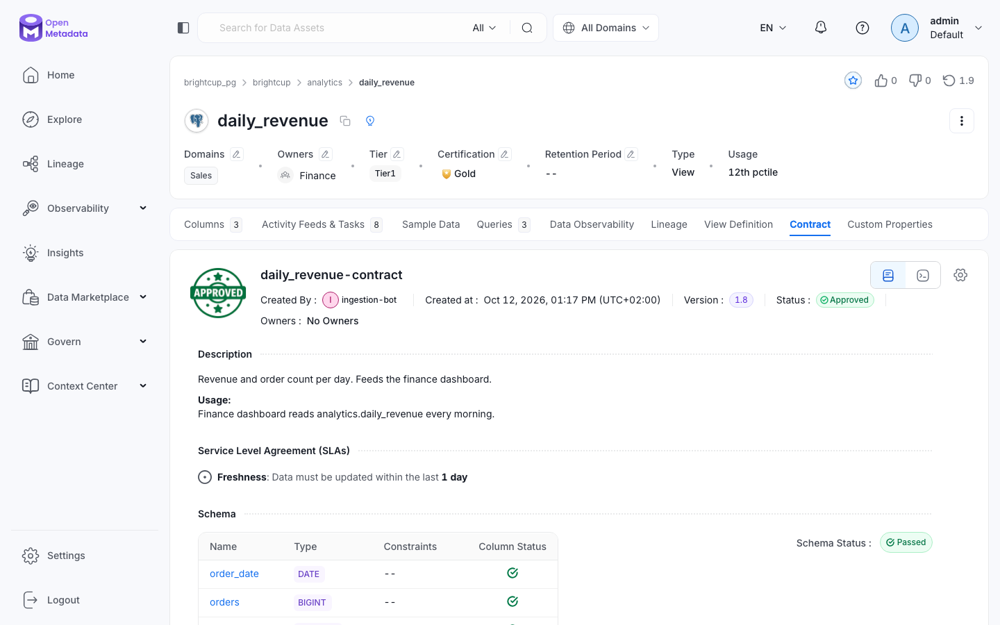

# 09 — Advanced use: access control, alerts, data contracts and AI assistants

Level 3: it zooms into "running OpenMetadata as a platform for a team" — who may do what, who gets told when something breaks, what a dataset promises, and how AI assistants use the catalog.

**What you will learn**
- Access control: users, teams, roles, policies (rules with resources, operations, conditions such as `isOwner()`, `matchAnyTag('PII.Sensitive')`), and how a request is decided (deny wins).
- Alerts: event subscriptions (`/v1/events/subscriptions`), test-failure triggers, webhook destinations, and delivery status.
- Data contracts: schema, semantics and quality expectations on an asset, validated to a per-section result — and what a contract does *not* see.
- The built-in MCP server (`/mcp`): what tools it exposes and how an assistant answers "how is revenue computed and can I trust it?".

All commands run from `project/`. Helpers live in `project/src/openmetadata_tutorial/ch09_*.py` (all idempotent: check-then-create, safe to re-run). This chapter builds on chapter 08's objects — team `Finance` owning `analytics.daily_revenue`, team `Data Engineering` owning `raw.orders`, user `dana.analyst` in Finance, PII tags on `raw.customers`, glossary term `Brightcup.Revenue` — and `ch09_access setup` re-asserts any of them that are missing. Other chapters write to the same running catalog, so you will see their fingerprints in some outputs (a data product, a Metabase dashboard, a Tier and a certification, extra alert events); each is pointed out where it appears.

## 1. Who is dana?

Dana is the analyst from chapter 08: a member of team Finance. The password lives in `project/.env` as `DANA_PASSWORD` (never hard-coded, never printed — tokens below are masked to 10 characters):

```bash
uv run python -m openmetadata_tutorial.ch09_access setup
```

```
team Finance: exists (8a76caa7-ccad-415d-80d4-952f2a6473b3)
team Data Engineering: exists (39d3fddc-4424-4495-8d80-9c3089d07e72)
owner of brightcup_pg.brightcup.analytics.daily_revenue: Finance already set
owner of brightcup_pg.brightcup.raw.orders: Data Engineering already set
user dana.analyst: exists (62173118-07ee-4569-813f-b01296626b7f)
user dana.analyst: password refreshed
user dana.analyst: already in team Finance
glossary Brightcup: exists
glossary term Brightcup.Revenue: exists
tag on brightcup_pg.brightcup.raw.customers: PII.Sensitive already set
```

Log in as dana and ask who she is:

```bash
uv run python -m openmetadata_tutorial.ch09_access whoami
```

```
dana login: ok, token eyJraWQiOi...
{
 "name": "dana.analyst",
 "email": "dana.analyst@brightcup.example",
 "teams": [
  "Finance"
 ],
 "roles": []
}
```

What it means for us: dana authenticates (a **user** with a password — fine for this local demo; production uses SSO), belongs to one **team** (Finance), and is granted no named **role** — `roles` is empty. The spec calls `DataConsumer` the default role: on the server that is the system role `DataConsumer` bundling the `DataConsumerPolicy` shown in the next section. Dana is never granted that role, yet the policy's broad allows still reach her — its EditRule allows those operations on `All` resources to every authenticated user, which is exactly why her description edits return 200 below. That broad default is the "default" in the name. Teams group people; roles bundle permissions; policies are the actual rules.

## 2. Read allowed, write denied — then a policy of our own

First, the default rules dana lives under — the actual `DataConsumerPolicy` from the server (`GET /v1/policies/name/DataConsumerPolicy`, one line per rule):

```bash
uv run python -m openmetadata_tutorial.ch09_access show-policy
```

```
DataConsumerPolicy-CreateTask-Rule: allow [Create] on [task]
DataConsumerPolicy-EditRule: allow [EditCertification, EditDescription, EditGlossaryTerms, EditTags, EditTier, ViewAll] on [All]
DataConsumerPolicy-TaskRule: allow [CreateTask, EditTask] on [All]
```

What it means for us: the EditRule already allows `EditDescription` (and `EditTags`, among others) on `All` resources to everyone. `EditOwners` and `ViewSampleData` appear nowhere in it. This printed policy is the "before" picture: it contains no deny rule at all, so before our policy exists no description PATCH as dana can return 403 — and after our policy exists, any 403 below must come from a rule we wrote, because this default only ever allows.

A **policy** is a named set of **rules**; each rule says allow-or-deny, which operations, on which resources, under which condition. Two conditions appear here: `isOwner()` (true when the caller's team owns the asset) and `matchAnyTag('PII.Sensitive')` (true when the asset carries that tag). A **role** bundles policies and is granted to a team. When several rules match one call, **deny wins** — one matching deny overrules any number of allows. Create both (`mkpolicy` creates-or-updates both policies, then grants the role to team Finance):

```bash
uv run python -m openmetadata_tutorial.ch09_access mkpolicy
```

```
policy FinanceEditRevenue: updated (d89cface-94b4-4fae-8518-ebe7e0b0c381)
policy NoPIIForConsumers: updated (d1baacb7-d717-4579-8c3a-7a13aa843304)
policies: FinanceEditRevenue d89cface-94b4-4fae-8518-ebe7e0b0c381 / NoPIIForConsumers d1baacb7-d717-4579-8c3a-7a13aa843304
role FinanceEditor: updated (4c703658-4f26-42b2-bc5b-f11873d9796e)
team Finance: already has role FinanceEditor
```

The two policies, rule by rule:

- `FinanceEditRevenue`: allow `EditDescription`, `EditTags` on resource `table` when `isOwner()` — exactly the spec's rule: Finance members may edit what they own.
- `NoPIIForConsumers`: deny `ViewSampleData` on resource `table` when `matchAnyTag('PII.Sensitive')` (the spec's deny rule), plus deny `EditDescription`, `EditTags` on `table` when `matchAnyTag('PII.Sensitive')`. That second deny is a documented 2.0.5 addition, not spec text: since the shipped default allows description/tag edits to everyone, no description PATCH could ever return 403 without it — and because deny wins, this one deny overrules the permissive default on tagged assets only.
- Role `FinanceEditor` holds both policies and is granted to team Finance — so dana gets the allow *and* the deny.

Now the access matrix. (`try_call` prints the status plus the first 220 characters of the answer; descriptions are restored afterwards so other chapters keep seeing the catalog as they left it. The customers PATCH is denied, so that table is untouched.)

```bash
uv run python -m openmetadata_tutorial.ch09_access matrix
```

```
dana login: ok, token eyJraWQiOi...
dana GET daily_revenue: 200
  -> {"id":"e61bcaa7-c285-4c0e-a347-d4343b7cd9ff","name":"daily_revenue","fullyQualifiedName":"brightcup_pg.brightcup.analytics.daily_revenue","description":"Revenue and order count per day. Feeds the finance dashboard.","ver
dana PATCH description daily_revenue: 200
  -> {"id":"e61bcaa7-c285-4c0e-a347-d4343b7cd9ff","name":"daily_revenue","fullyQualifiedName":"brightcup_pg.brightcup.analytics.daily_revenue","description":"Edited by the ch09 access demo.","version":1.8,"updatedAt":17918088
dana PATCH description raw.customers: 403
  -> {"code":403,"message":"Principal: CatalogPrincipal{name='dana.analyst'} operation EditDescription denied by role FinanceEditor, policy NoPIIForConsumers, rule NoPIIForConsumers-DenySensitiveEdits"}
dana PATCH description raw.orders: 200
  -> {"id":"463468b2-da6c-4c6e-a527-28a4c56f6436","name":"orders","fullyQualifiedName":"brightcup_pg.brightcup.raw.orders","description":"Edited by the ch09 access demo.","version":1.8,"updatedAt":1791808835487,"updatedBy":"d
dana GET raw.customers sampleData: 403
  -> {"code":403,"message":"Principal: CatalogPrincipal{name='dana.analyst'} operation ViewSampleData denied by role FinanceEditor, policy NoPIIForConsumers, rule NoPIIForConsumers-DenySensitiveSamples"}
dana GET raw.products sampleData: 200
  -> {"id":"7510b1c0-31c0-44ba-85f9-48de84768949","name":"products","fullyQualifiedName":"brightcup_pg.brightcup.raw.products","version":0.3,"updatedAt":1791805229505,"updatedBy":"ingestion-bot","tableType":"Regular","columns
descriptions: restored
```

Read allowed, write denied — with a real 403 on a description PATCH: editing `raw.customers` (tagged `PII.Sensitive` at table level) is denied, and the message names its decider in full — role `FinanceEditor`, policy `NoPIIForConsumers`, rule `NoPIIForConsumers-DenySensitiveEdits`. That is what you debug with. One honest disagreement with the spec: it expects the `raw.orders` PATCH to return 403 (denied because another team owns it), but on 2.0.5 it returns 200 — the shipped default allows description edits to everyone and no rule denies them on that untagged table, so the `isOwner()` condition never gets to switch anything for descriptions. The ownership idea still stands (the allow rule is scoped to owned tables), but the observable enforcement on this server version is the deny side.

The full matrix, one table:

| dana's call | status | decided by |
|---|---|---|
| GET `daily_revenue` | 200 | readable by consumers |
| PATCH `daily_revenue` description (Finance owns it) | 200 | default EditRule allows; our `isOwner()` allow matches too |
| PATCH `raw.customers` description (tagged `PII.Sensitive`) | 403 | `NoPIIForConsumers` deny rule (deny wins over the default) |
| PATCH `raw.orders` description (untagged, other owner) | 200 | default EditRule — on 2.0.5 ownership alone denies nothing here |
| GET `raw.customers` sampleData (tagged `PII.Sensitive`) | 403 | `NoPIIForConsumers` deny rule |
| GET `raw.products` sampleData (not tagged) | 200 | no rule matches, read allowed |

> **Important:** policies combine; deny wins; conditions use ownership and tags.
> **What it means for us:** governance (chapter 08) is what makes access rules expressible — both deny rules match the table-level `PII.Sensitive` tag (column tags alone do not gate table-level reads and writes), and the allow rule matches the table's owner. No owners/tags, no fine-grained access.
> **Why it matters:** if you write a rule against column tags and test it on a table call, it will silently not match and you will conclude the rule is broken.

## 3. Alerts: a failing test notifies the webhook

An **event subscription** watches the catalog for something (here: a test case turning `Failed`) and calls a **destination** (here: a webhook URL). Subscriptions come in types: `Observability` watches operational signals such as test results going red — as opposed to `Notification` announcements or activity-feed digests — and on this server version only the `Observability` (and ActivityFeed/Custom) types can filter on `testCase` resources, so the type choice below is forced, not free. Its limit: it fires on status *updates* — re-running a suite with failing tests produces fresh result events, which is exactly the trigger used here. Create it, then clear the local receiver so the next events are ours:

```bash
uv run python -m openmetadata_tutorial.ch09_alerts ensure
uv run python -m openmetadata_tutorial.ch09_alerts clear
```

```
alert ch09_quality_to_webhook: updated (f2f8c894-2d0f-4a11-9001-aefa62224c60)
  destination: Webhook -> http://webhook:8000/om
  action: matchTestResult({'Failed'})
receiver: cleared
```

The subscription watches resource `testCase` with a `GetTestCaseStatusUpdates` action filtered to `Failed`.

Trigger it by re-running chapter 07's customers quality suite, which contains genuinely failing tests (trimmed log — middle lines cut, nothing edited):

```bash
just ingest ch07_customers_quality test
```

```
[2026-10-12 12:41:05] INFO     {metadata.TestSuite:core:31} - Executing test case customers_country_in_set for entity brightcup_pg.brightcup.raw.customers
[2026-10-12 12:41:05] INFO     {metadata.TestSuite:core:31} - Executing test case customers_email_not_null for entity brightcup_pg.brightcup.raw.customers
[2026-10-12 12:41:05] INFO     {metadata.TestSuite:core:31} - Executing test case customers_email_unique for entity brightcup_pg.brightcup.raw.customers
...
[2026-10-12 12:41:06] INFO     {metadata.Utils:logger:223} - Workflow Success %: 100.0
```

(The workflow itself succeeds — it ran the checks; the *test cases* fail. That distinction matters: Airflow green, data red.)

Then wait for the event. Other chapters share this catalog, so their failing tests can land in the receiver too — `wait` therefore shows the first event for the suite this chapter re-ran (`customers`), not blindly the first arrival:

```bash
uv run python -m openmetadata_tutorial.ch09_alerts wait
```

```
receiver: live, got 2 event(s)
{
 "path": "/om",
 "eventType": "entityUpdated",
 "entityType": "testCase",
 "entityFullyQualifiedName": "brightcup_pg.brightcup.raw.customers.email.customers_email_not_null",
 "testCaseStatus": "Failed",
 "timestamp": 1791808856693
}
```

What it means for us: the failing email-not-null test fired the subscription and the server delivered an `entityUpdated` event for that test case with status `Failed` — a trimmed view; the full body carries the result message (`Found nullCount=12`), the incident id and the version change. The receiver held 2 events on this run — expect a different number on yours, because parallel chapters keep emitting into the same receiver; ours is the customers one shown. Delivery status confirms nothing was lost:

```bash
uv run python -m openmetadata_tutorial.ch09_alerts status
```

```
{
 "totalEventsCount": 340,
 "pendingEventsCount": 0,
 "successfulEventsCount": 340,
 "failedEventsCount": 0
}
```

(340 total here, a larger number on yours — the counters grow as the shared catalog keeps emitting; pending 0 / failed 0 is the point.)

> **Important:** alert destinations are called from the server, so the URL must be reachable from the server's network.
> **What it means for us:** the endpoint is `http://webhook:8000/om` (the receiver's address inside Docker), not `localhost:18090` (our address outside it).
> **Why it matters:** this is the most common "alerts don't arrive" cause — the subscription looks right and the status stays empty because the server cannot reach your localhost.

## 4. Data contract: what `daily_revenue` promises

A **data contract** states what an asset promises: its **schema** (columns and types), **semantics** (rules about the asset itself) and **quality expectations** (test cases that must pass). The starting document is written in **ODCS** — the Open Data Contract Standard, a vendor-neutral YAML shape for writing down what a dataset promises (name, columns and types, quality wishes) that many tools can read. Here it is the on-ramp: we hand the server this document and it builds the contract. It is built in four small steps, one new thing each.

**Step 1 — the ODCS document: schema.** This is the document, printed by `print-odcs` and sent byte-for-byte by `import-odcs` (`username: Finance` is the spelling that resolves on this server version; `name:` does not):

```bash
uv run python -m openmetadata_tutorial.ch09_contract print-odcs
```

```yaml
apiVersion: v3.1.0
kind: DataContract
name: daily_revenue-contract
status: active
description:
  purpose: Revenue and order count per day. Feeds the finance dashboard.
  usage: Finance dashboard reads analytics.daily_revenue every morning.
team:
  members:
    - username: Finance
      role: owner
schema:
  - name: daily_revenue
    logicalType: object
    properties:
      - name: order_date
        logicalType: date
        physicalType: DATE
        description: The business day (one row per day).
      - name: orders
        logicalType: integer
        physicalType: BIGINT
        description: Orders placed that day, excluding cancelled ones.
      - name: revenue
        logicalType: number
        physicalType: NUMERIC
        description: Sum of total_amount in EUR for that day.
    quality:
      - id: daily_revenue_has_rows
        name: Daily revenue has between 1 and 1000 rows
        metric: rowCount
        mustBeBetween: [1, 1000]
slaProperties:
  - property: freshness
    value: 1
    unit: d
    element: daily_revenue.order_date
```

Import it:

```bash
uv run python -m openmetadata_tutorial.ch09_contract import-odcs
```

```
contract: daily_revenue-contract (231b70a4-3f84-4215-9b09-cef033ff9a98) status=Approved
  schema columns: ['order_date', 'orders', 'revenue']
  odcsQualityRules: 1
  linked quality expectations: 0
```

What it means for us: the merge brings the three schema columns plus the ODCS `quality:` block — but only as informational `odcsQualityRules` (count 1: row count between 1 and 1000). The *linked* count reads 0: no test case executes yet. (Note for re-runs: the ODCS merge resets the sections the file does not own — linked expectations and semantics drop back to empty — which is exactly why steps 2 and 3 below are separate re-runnable steps.)

**Step 2 — the runnable test: link it.** First create the row-count test the contract will execute (`just ingest ch09_daily_revenue_quality test`, trimmed):

```
[2026-10-12 12:41:22] INFO     {metadata.TestSuite:test_suite:105} - Retrieving table entity for FQN: brightcup_pg.brightcup.analytics.daily_revenue
[2026-10-12 12:41:22] INFO     {metadata.TestSuite:core:31} - Executing test case daily_revenue_has_rows for entity brightcup_pg.brightcup.analytics.daily_revenue
...
[2026-10-12 12:41:22] INFO     {metadata.Utils:logger:223} - Workflow Success %: 100.0
```

Then link it as the contract's quality expectation and a member of the contract's own test suite (validation executes that suite — linking is what makes the ODCS wish actually run):

```bash
uv run python -m openmetadata_tutorial.ch09_contract link-quality
```

```
contract quality: linked daily_revenue_has_rows
contract suite: test case added
```

**Step 3 — semantics the ODCS file cannot express.** Two metadata rules in **JSON Logic** — a tiny JSON syntax for true/false checks ("owners is not empty") that the server evaluates without code; each semantics entry is one such rule with a name. The asset must have an owner and a description — added via API:

```bash
uv run python -m openmetadata_tutorial.ch09_contract semantics
```

```
contract semantics: added ['Owners is set', 'Description is set']
```

**Step 4 — the owner the semantics rule reads.** Ownership lives on the *table*, not on the contract object (`GET /v1/dataContracts/{id}` has no `owners` field at all) — the "Owners is set" rule checks the table's owners, which chapter 08 assigned to Finance and step `ch09_access setup` re-asserts:

```bash
uv run python -m openmetadata_tutorial.ch09_contract owner-check
```

```
contract owner: Finance owns daily_revenue (on the table)
```

(One command runs all four when you just want the end state: `ch09_contract import`.)

**Validate it:**

```bash
uv run python -m openmetadata_tutorial.ch09_contract validate
```

```
validation: Success
  schema: 3/3 columns passed
  semantics: 2/2 rules passed
  quality: {"passed": 1, "failed": 0, "total": 1, "qualityScore": 100.0}
```

What it means for us: every section passes — 3 of 3 schema columns, 2 of 2 semantics rules, the 1 linked quality test. (Validation is asynchronous: the trigger POST returns `Running` with no quality section yet — printed as `quality: null` while in flight — because the quality section runs as an Airflow pipeline; the helper polls `/results/latest` to the final state for up to ~5 minutes. If you ever see `validation: Running` with `quality: null`, the pipeline is still queued — wait ~30 s and re-run `validate`. The counting behind the lines above is unit-tested offline in `project/tests/test_ch09_contract.py`.)

**And the summary view** (pasted exactly as printed):

```bash
uv run python -m openmetadata_tutorial.ch09_contract show
```

```
{
 "name": "daily_revenue-contract",
 "entityStatus": "Approved",
 "entity": "brightcup_pg.brightcup.analytics.daily_revenue",
 "tableOwners": [
  "Finance"
 ],
 "schema": [
  [
   "order_date",
   "DATE"
  ],
  [
   "orders",
   "BIGINT"
  ],
  [
   "revenue",
   "NUMERIC"
  ]
 ],
 "semantics": [
  "Owners is set",
  "Description is set"
 ],
 "qualityExpectations": [
  "daily_revenue_has_rows"
 ],
 "latestResult": {
  "timestamp": 1791808903493,
  "status": "Success",
  "resultId": "10e2a018-bde7-4650-9892-0c1e2818dc23"
 }
}
```

The Contract tab shows the same green state — APPROVED, description and freshness SLA taken straight from the ODCS document, Schema Status Passed:



(The `Owners: No Owners` line in the header refers to the *contract object*, which carries no owners on this server version — the ownership the semantics rule checks lives on the table, as step 4 shows. The Sales domain, Tier1 and Gold badge are other chapters' fingerprints.)

**The instructive failure: green here, red upstream.** This contract is green while the tables `daily_revenue` is built from fail quality right now — the evidence, from this chapter (same query as chapter 07's results table, sorted so re-runs print the same order):

```bash
uv run python -m openmetadata_tutorial.ch09_contract upstream
```

```
customers.customers_country_in_set: Failed (columnValuesToBeInSet) -- Found countInSet=148.
customers.customers_email_not_null: Failed (columnValuesToBeNotNull) -- Found nullCount=12. It should be 0
orders.orders_no_negative_amounts: Failed (tableCustomSQLQuery) -- Found 5 row(s). Test query is expected to return <= 0 row(s).
orders.orders_order_id_unique: Failed (columnValuesToBeUnique) -- Found valuesCount=1000 vs. uniqueCount=994. Both counts should be equal for column values to be unique.
orders.orders_status_in_set: Failed (columnValuesToBeInSet) -- Found countInSet=996.
```

Five failing tests upstream — duplicate order ids, negative amounts, a misspelled status, null emails, an out-of-set country — and the contract still says Success.

> **Important:** a contract describes the asset itself; upstream tests cannot be folded into it.
> **What it means for us:** the ODCS document has no field for other assets' tests, and validation runs the contract's own test suite on this asset alone (the contract carries its own `testSuite` id — there is no upstream section in the result above). Saying it plainly: on 2.0.5 there is no supported way to put the upstream tests into this contract.
> **Why it matters:** testing only the final table is the most common false comfort in data quality — chapter 01's "quality upstream + lineage = trust downstream". The alert from section 3 is what covers the upstream failures today.

## 5. AI assistants via MCP

The server exposes a built-in **MCP** endpoint at `/mcp`. MCP — the Model Context Protocol — is an open standard letting an AI assistant call tools on a server (search the catalog, read lineage) instead of guessing from training data. Calls are **JSON-RPC** over HTTP: each request is a small JSON envelope (`{"jsonrpc": "2.0", "id": 1, "method": "tools/list", "params": {...}}`) with headers `Accept: application/json, text/event-stream` and `Authorization: Bearer <token>`. `ch09_mcp.py` is a minimal client using only `requests`: `initialize`, `tools/list`, then three tool calls answering "how is revenue computed and can I trust it?":

```bash
uv run python -m openmetadata_tutorial.ch09_mcp
```

```
mcp server: openmetadata-mcp-stateless 1.1.0
mcp auth: Bearer eyJraWQiOi... (ingestion-bot token for this demo; a read-only identity in production)
tools (15): company_context, search_metadata, semantic_search, get_entity_details, get_persona_context, get_user_context, find_context, create_entity, describe_entity_type, patch_entity, get_entity_lineage, create_lineage, get_test_definitions, create_test_case, root_cause_analysis
search_metadata 'revenue': Found 8 total results, showing first 5. There are many matching assets. Are you looking for something specific? Try narrowing with a service name, schema name, or more specific search term.
  - tableColumn: brightcup_pg.brightcup.analytics.daily_revenue.revenue
  - glossaryTerm: Brightcup.Revenue
  - table: brightcup_pg.brightcup.analytics.daily_revenue
  - dataProduct: Revenue Reporting
  - chart: brightcup_metabase.revenue_by_day
lineage of daily_revenue: 3 upstream edge(s), 1 downstream
  - brightcup_pg.brightcup.analytics.fct_orders -> brightcup_pg.brightcup.analytics.daily_revenue
  - brightcup_pg.brightcup.raw.customers -> brightcup_pg.brightcup.analytics.fct_orders
  - brightcup_pg.brightcup.raw.orders -> brightcup_pg.brightcup.analytics.fct_orders
  - brightcup_pg.brightcup.analytics.daily_revenue -> brightcup_metabase.finance_overview
glossary Brightcup.Revenue: Sum of total_amount of non-cancelled orders, in EUR, by order date.
semantic_search: {"returnedCount":0,"totalFound":0,"error":"Semantic search is not enabled. Configure vector embeddings in the OpenMetadata server settings.","results":[]}
```

What it means for us: one question decomposes into three tool calls — *what does revenue mean* (glossary term `Brightcup.Revenue`), *how is it computed* (lineage: raw orders and customers through `fct_orders` into `daily_revenue` — 3 upstream edges — then out to the `finance_overview` dashboard, the 1 downstream; the dashboard and `Revenue Reporting` data product are other chapters' fingerprints), *can I trust it* (test results via the same lineage, chapters 01/07). `semantic_search` answers honestly that no embeddings provider is configured in this stack — keyword `search_metadata` is the working search here, and that limit is stated where the tool is introduced: use keyword search unless your server has embeddings wired up. (The `mcp auth` line names the token actually used — the ingestion-bot token from `.env`, falling back to an admin login — precisely because MCP calls run with that token's full permissions. In production it must be a bot/user with a read-only role.) To connect a real assistant (not run here):

```bash
claude mcp add --transport http openmetadata http://localhost:18585/mcp --header "Authorization: Bearer $OM_JWT_TOKEN"
```

> **Important:** MCP calls run with the token's full permissions — give assistants a dedicated read-only identity and review the write tools.
> **What it means for us:** this demo uses the ingestion-bot (admin-level) token; in production it must be a bot/user with a read-only role, because tools like `patch_entity` and `create_lineage` can rewrite descriptions and lineage at scale.
> **Why it matters:** an assistant with a broad token turns a misunderstanding into thousands of confident edits.

## The advanced layer in one table

| feature | what it needs (from earlier chapters) | Brightcup object |
|---|---|---|
| access control | owners (08), PII tags (classify/08) | policies `FinanceEditRevenue`, `NoPIIForConsumers`; role `FinanceEditor` on team Finance |
| alerts | failing tests (07) | subscription `ch09_quality_to_webhook` → webhook on `Failed` test cases |
| data contract | owner + description (08), row-count test (this chapter) | `daily_revenue-contract` on `analytics.daily_revenue`, validation Success — blind to the 5 failing upstream tests |
| AI assistants | glossary (08), lineage (06), tests (07) | MCP tools answering revenue meaning, computation (3 up / 1 down) and trust |

## Carry forward

- Access = **roles + policies over owners and tags**; prove rules with real 200/403 — and read the 403 message, it names the denied operation.
- Alerts turn **events (test failures, schema changes) into messages** to owners — but only if the destination URL is reachable from the server.
- Contracts state **what an asset promises** (schema, semantics, quality) — green locally, blind upstream, because upstream tests are not expressible in the contract.
- MCP lets **AI assistants use the catalog** (search, lineage, glossary) — with a scoped read-only identity, because the token's permissions are the assistant's permissions.
