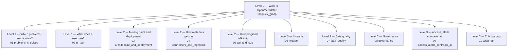

# 10 — Wrap-up: the map, summary, FAQ and exercises

**What you will learn**
- The whole tutorial on one page: the levels tree and the Brightcup object each chapter added.
- The final state of our catalog, counted by a script — real numbers, as observed.
- The map beyond the tutorial: other connectors, dbt, Data Insights, AutoPilot, semantic search, Context Center, the marketplace, and Collate extras.
- A production checklist, short answers to frequent questions, and exercises that each change exactly one thing.
- How to stop the stack, and how to remove it completely when you are done.

This is the closing chapter. It looks at the whole tree from above and at what lies beyond it. Question: *what did we build, where does it fit in the full product, and what do I do next?*

## 1. The tree, filled in

In everyday words: we started with one running catalog, learned what it is for and what it looks like, then how it works inside, then each job in depth. Precisely, the levels tree from `plan.md` with every leaf naming its chapter:



Each chapter added exactly one idea — and, where the idea needed it, one thing in the running example:

| chapter | the one idea | the Brightcup object it added |
|---|---|---|
| 00 | OpenMetadata is a server that holds metadata; connectors fill it, people and programs read it | the stack up, a bot token, the first ingestion of service `brightcup_pg` |
| 01 | five jobs — find, understand, trace, trust, govern — on the same entities | `just bootstrap` outputs: profiles, lineage edges, 4 test results, auto PII tags |
| 02 | the table page is the hub; search plus descriptions, tags and owners is how people discover | no objects (UI tour, screenshots) |
| 03 | five parts, one door (REST); the store is the truth, the index a copy | no objects (compose map, upgrade path) |
| 04 | a workflow is source → what-to-read → sink; re-runs are idempotent, deletions soft | service `brightcup_sandbox` + schema `sandbox` (not present on this stack today — see §2) |
| 05 | one API shape for all entities; changes are JSON Patch → new versions | edits through the API (today `raw.products` carries no descriptions — nothing persisted) |
| 06 | edges come from view SQL, the query log, or the API; impact analysis is a downstream walk | dashboard service `brightcup_metabase`, dashboard `finance_overview`, one Manual edge, view `analytics.ch06_dynamic` |
| 07 | profile to see, test to decide, incident to act | 8 test cases, 5 failed: 3 on `raw.orders` (duplicates, negatives, `shiped`), 2 on `raw.customers` (NULL emails, country set) |
| 08 | governance is owner + tier + classification + glossary + domain on each asset | glossary `Brightcup` (4 terms), domain `Sales`, data product `Revenue Reporting`, teams `Finance` / `Data Engineering`, user `dana.analyst`, `Tier.Tier1` + Gold certification on `daily_revenue` |
| 09 | roles + policies over owners and tags; events → messages; contracts state promises; MCP for assistants | policies `FinanceEditRevenue` / `NoPIIForConsumers`, role `FinanceEditor`, alert `ch09_quality_to_webhook`, contract `daily_revenue-contract`, test case `daily_revenue_has_rows` |

## 2. The final state, real

One script counts what exists now. It is read-only — every function is a thin wrapper over GET calls (`client.get`). Whatever the other chapters created shows here as observed; anything a chapter has not created yet simply shows 0. From `project/`:

```bash
$ uv run python -m openmetadata_tutorial.ch10_inventory
== tables per service ==
  brightcup_pg: 8 table(s)
    brightcup_pg.brightcup.analytics.ch06_dynamic
    brightcup_pg.brightcup.analytics.customer_ltv
    brightcup_pg.brightcup.analytics.daily_revenue
    brightcup_pg.brightcup.analytics.fct_orders
    brightcup_pg.brightcup.raw.customers
    brightcup_pg.brightcup.raw.order_items
    brightcup_pg.brightcup.raw.orders
    brightcup_pg.brightcup.raw.products
== lineage downstream of raw.orders ==
  5 edge(s)
    brightcup_pg.brightcup.raw.orders -> brightcup_pg.brightcup.analytics.fct_orders  [ViewLineage]
    brightcup_pg.brightcup.raw.orders -> brightcup_pg.brightcup.analytics.ch06_dynamic  [ViewLineage]
    brightcup_pg.brightcup.analytics.fct_orders -> brightcup_pg.brightcup.analytics.daily_revenue  [ViewLineage]
    brightcup_pg.brightcup.analytics.fct_orders -> brightcup_pg.brightcup.analytics.customer_ltv  [QueryLineage]
    brightcup_pg.brightcup.analytics.daily_revenue -> brightcup_metabase.finance_overview  [Manual]
== test cases ==
  8 test case(s), 5 failed
    Failed         customers_country_in_set  (on country)
    Failed         customers_email_not_null  (on email)
    Success        customers_email_unique  (on email)
    Success        daily_revenue_has_rows  (on brightcup_pg.brightcup.analytics.daily_revenue)
    Failed         orders_no_negative_amounts  (on brightcup_pg.brightcup.raw.orders)
    Failed         orders_order_id_unique  (on order_id)
    Success        orders_row_count_between  (on brightcup_pg.brightcup.raw.orders)
    Failed         orders_status_in_set  (on status)
== PII-tagged columns ==
  0 column(s)
== glossary terms ==
  4 term(s): Customer, Lifetime value, Order, Revenue
== owners of the 7 Brightcup assets ==
    customers       Data Engineering
    products        (none)
    orders          Data Engineering
    order_items     (none)
    fct_orders      (none)
    daily_revenue   Finance
    customer_ltv    (none)
== event subscriptions (alerts) ==
  3 subscription(s): ActivityFeedAlert, ch09_quality_to_webhook, WorkflowEventConsumer
== data contracts ==
  1 contract(s): daily_revenue-contract
== installed apps ==
  AutoPilotApplication, DataContractValidationApplication, DataInsightsApplication, DataRetentionApplication, McpApplication, RdfIndexApp, SearchIndexingApplication
```

What this means for us: the catalog holds 8 tables under one database service; every Brightcup question from chapter 01 is still answerable — revenue is findable (`daily_revenue`, owned by Finance, Tier1, Gold, in domain `Sales`), traceable (5 downstream edges ending at the `finance_overview` dashboard), and its trust state is explicit (8 test cases, 5 failed: 3 on `raw.orders` — the planted duplicates, negative amounts and `shiped` status — plus 2 on `raw.customers`: `customers_email_not_null` catches the 12 planted NULL emails, and `customers_country_in_set` fails on the country column; `customers_email_unique` and the row-count and `daily_revenue` checks are green). Two honest gaps: no column carries a `PII.*` tag right now (chapter 08 corrected the `signup_date` false positive; re-running `just ingest classify` restores the auto tags), and the chapter 04 sandbox service is absent — that chapter had not finished on this stack when I ran the count. Zeros are results too: they are the backlog.

> **Important:** a catalog is a practice, not a tool install.
> **What it means for us:** owners, descriptions, tests and reviews need people and a cadence — the empty cells above (no owner on `products`, no PII tags anywhere) are tasks for someone, not missing features.
> **Why it matters:** most catalog rollouts stall right after ingestion: everything is connected, nothing is trusted, nobody looks again.

## 3. The map beyond the tutorial

The tutorial cataloged one Postgres database by hand-run YAMLs. The full product is wider. Each row is one area, what it does, the first step, and a doc link — every link below was opened and returned HTTP 200 on 2026-10-12:

| area | what it does | first step | doc link |
|---|---|---|---|
| Other database connectors | 50+ database sources (Snowflake, BigQuery, Databricks…) with the same six workflow types | browse the connector index, pick one, copy its YAML shape | `https://docs.open-metadata.org/v2.0.x/connectors` |
| Dashboard connectors | imports dashboards/charts and their lineage (Tableau, Looker, Metabase…) | create a dashboard service, run its metadata workflow | `https://docs.open-metadata.org/v2.0.x/connectors/dashboard` |
| Pipeline connectors | imports DAGs/tasks and their lineage (Airflow, dbt Cloud, Dagster…) | create a pipeline service for the orchestrator you already run | `https://docs.open-metadata.org/v2.0.x/connectors/pipeline` |
| Messaging (Kafka) | catalogs topics, schemas and event lineage | create a messaging service, run its metadata workflow | `https://docs.open-metadata.org/v2.0.x/connectors/messaging/kafka` |
| ML (MLflow) | catalogs models, runs, metrics and parameters | create an MLmodel service pointing at your tracking server | `https://docs.open-metadata.org/v2.0.x/connectors/ml-model/mlflow` |
| Storage (S3) | catalogs buckets/containers and file-level metadata | create a storage service with your bucket credentials | `https://docs.open-metadata.org/v2.0.x/connectors/storage/s3` |
| Search and API services | catalogs search indexes and REST endpoints as assets | create a search or API service | `https://docs.open-metadata.org/v2.0.x/connectors` |
| dbt integration | imports descriptions, tests, owners, tiers, glossary and lineage from dbt artifacts (`manifest.json`, `catalog.json`, `run_results.json`) | configure one dbt workflow pointing at your artifacts | `https://docs.open-metadata.org/v2.0.x/connectors/database/dbt/configure-dbt-workflow` |
| Data Insights and KPIs | reports description/ownership coverage and tiering over time (runs as an app) | open the Data Insights dashboards, define one KPI | `https://docs.open-metadata.org/v2.0.x/how-to-guides/data-insights` |
| Data contracts | promised schema, quality and SLA per asset, validated by the contract app | extend `daily_revenue-contract` with one more expectation | `https://docs.open-metadata.org/v2.0.x/how-to-guides/data-contracts` |
| AutoPilot | runs the metadata workflows automatically whenever a service is added | enable it under Settings → Applications | `https://docs.open-metadata.org/applications/autopilot` |
| Semantic search and AI features | vector embeddings plus an LLM provider for natural-language search (`semantic_search` MCP tool needs it) | configure embeddings and the provider, then reindex | `https://docs.open-metadata.org/v2.0.x/deployment/semantic-search` |
| MCP server | the built-in Model Context Protocol endpoint (`/mcp`) for AI assistants | connect a client with a scoped bot token (09) | `https://docs.open-metadata.org/v2.0.x/how-to-guides/mcp` |
| Context Center | articles, memories and uploaded documents shared with people and MCP search | write one article about how revenue is computed | `https://docs.open-metadata.org/v2.0.x/how-to-guides/context-center` |
| Data marketplace | domains and data products as the published shop window (we built one: `Sales` / `Revenue Reporting`) | publish a second data product for another team | `https://docs.open-metadata.org/v2.0.x/how-to-guides/data-marketplace` |
| Data retention | deletes old metadata (versions, test results, activity) on a schedule | review the app defaults before enabling | installed app `DataRetentionApplication` (Settings → Applications) |
| Search reindex | rebuilds the Elasticsearch index from the metadata store | reindex after upgrades or bulk imports | `https://docs.open-metadata.org/v2.0.x/how-to-guides/admin-guide/reindexing-search` |
| Backups | back up and restore the metadata store | schedule backups of Postgres before any upgrade | `https://docs.open-metadata.org/v2.0.x/deployment/backup-restore-metadata` |
| Collate (managed) extras | the SaaS offering by Collate, the company behind OpenMetadata | compare self-hosted vs managed on their site | `https://docs.getcollate.io/` |

The bridge from our stack to that map is the app list from §2: seven applications are installed (`AutoPilotApplication`, `DataContractValidationApplication`, `DataInsightsApplication`, `DataRetentionApplication`, `McpApplication`, `RdfIndexApp`, `SearchIndexingApplication`). Each map row above is either one of these apps or a connector family away.

> **Important:** coverage before features.
> **What it means for us:** connect the sources people actually use — including the BI tool — before adding contracts and AI on top.
> **Why it matters:** lineage and search are only as good as their coverage; a contract on an untraced asset promises what you cannot verify.

## 4. Production checklist

One line each, pointing at its chapter:

**Deploy**
- Same image version everywhere (server, ingestion, metadata image) — 03.
- External managed database and search instead of one-host containers — 03.
- SSO instead of `admin`/`admin`, with fresh `FERNET_KEY` and JWT keys — 03/09.
- Back up the metadata store (Postgres), not just the search index — 03.

**Security**
- One bot per automation (assistants get a read-only one through MCP); never an admin token in a YAML — 04/09.
- Deny rules before grants; prove them with a real 403 — 09.

**Ingestion**
- Workflow order: metadata → usage/lineage → profiler/classify → quality — 04.
- Connection addresses must resolve where the workflow runs (Docker names in Airflow) — 04.
- Decide the source of truth per field (source comment vs catalog edit vs dbt) and set `overrideMetadata` accordingly — 04/08.
- Schedule pipelines in the UI or your own orchestrator; CLI runs leave no status history — 04.

**Quality and governance**
- Owners are teams, not people — 08.
- Auto classification suggests; a human confirms (fix false positives like `signup_date`) — 08.
- Link the glossary to columns, or it is a wiki nobody reads — 08.
- Profile to see, test to decide, incident to act — with an owner on the incident — 07.

**Operations**
- Alert endpoints must be reachable from the server (Docker address, not localhost) — 09.
- Upgrade path: back up, same-version images, migrate, reindex if told to (`https://docs.open-metadata.org/v2.0.x/deployment/upgrade/docker`) — 03.

## 5. Summary

OpenMetadata is a server that holds metadata while connectors fill it and people, programs and assistants read and enrich it (00). Everything it stores is an entity with an FQN and versions, reachable by UI, API, SDK and MCP (00/02/05/09). It does five jobs — find, understand, trace, trust, govern — on the same entities, and the jobs combine: quality upstream plus lineage gives trust downstream (01). The server is the only door; the Postgres store is the truth and the search index a rebuildable copy (03). Ingestion workflows are source → what-to-read → sink, idempotent on re-run, soft on delete, runnable from any scheduler or as UI-scheduled pipelines (04). Lineage comes from view SQL, the query log, or the API, and impact analysis is a downstream walk that is only as good as its coverage (06). Data quality means profiling to see, tests as entities with history to decide, and incidents with owners to act (07). Governance is owners plus tiers, classifications, glossary meanings and domain groupings, all versioned tags and references on entities (08). Access is roles plus policies over owners and tags, alerts turn events into messages, contracts state what an asset promises, and value comes from coverage plus ownership plus tests plus alerts, in that order (09/10).

## 6. FAQ

**Does OpenMetadata copy my data?**
No. Connectors read names, schemas, statistics, query text and lineage — never the rows, except small configured samples (profiler sample data, used e.g. for the PII check in 09). The profiler is the one workflow that queries your tables, so sample consciously on large or sensitive sources (04/07).

**Do I need Airflow?**
No. Airflow (in the ingestion container) only schedules UI-created ingestion pipelines. Any scheduler — cron, your own Airflow, GitHub Actions — can run the same `metadata` CLI commands (03/04).

> **Important:** keep the source of truth explicit per field.
> **What it means for us:** decide for each field whether the source comment, a catalog edit, or dbt wins, and set `overrideMetadata` to match.
> **Why it matters:** this is the commonest confusion in chapters 04/08 — re-ingestion either silently discards curation or silently ignores source updates.

**Why did my UI description not change after re-ingestion?**
Re-runs keep catalog edits by default. If you changed the source (a Postgres `COMMENT`, a dbt description) and want it to win, set `overrideMetadata: true` in the workflow YAML and re-run (04).

**Why is my column-level lineage missing?**
Three usual causes: the edge came from the query log and the query fell outside `queryLogDuration` (re-run the lineage workflow regularly); the SQL used constructs the parser does not resolve (chapter 06 shows this with `ch06_dynamic`); or the consumer was never connected — Python jobs, Spark jobs and unconnected BI tools are invisible until a connector or a manual edge adds them (06).

**Why does my test always pass?**
If it is a `columnValuesToBeInSet` test, you probably missed `matchEnum: "true"` — without it, values outside the set do not fail. Also check `supportedDataTypes` for your column type, and `forceUpdate: true` if you changed parameters in YAML but the catalog kept the old ones (07).

**Why didn't my alert arrive?**
Check three things in order: the event matched the alert's filter (test-failure alerts only fire on failures); the destination URL is reachable *from the server container* (`http://webhook:8000/...`, not `localhost`); and the delivery status on the subscription entity. Then look in the receiver with `just events` (09).

**How do I upgrade?**
Back up the metadata store, pull the new images (server, ingestion and metadata images, same version), run the migrations, start the server, and reindex search if the release notes say so. Read the release notes first — the 1.13→2.0 notes list breaking changes per area. Steps for our setup: `https://docs.open-metadata.org/v2.0.x/deployment/upgrade/docker` (03).

**OpenMetadata vs DataHub / Amundsen / Unity Catalog?**
One neutral paragraph, facts only. DataHub (built at LinkedIn, open-sourced in 2020, Apache 2.0) centers on a streaming metadata graph with a GraphQL API (`https://github.com/datahub-project/datahub`, `https://docs.datahub.com/docs/api/graphql/overview`). Amundsen (a Python/Neo4j-based discovery tool, Apache 2.0) was archived by its owners in September 2026 and is now read-only (`https://github.com/amundsen-io/amundsen`). Unity Catalog (Databricks, open-sourced June 2024, Apache 2.0) governs tables, files and AI assets with OpenAPI/REST interfaces (`https://www.databricks.com/company/newsroom/press-releases/databricks-open-sources-unity-catalog-creating-industrys-only-open`, `https://github.com/unitycatalog/unitycatalog`). OpenMetadata (Apache 2.0) is the REST-plus-MCP catalog of this tutorial: entities with FQNs, six ingestion workflow types, tests as entities, and apps for insights, contracts and AI access.

**Can an AI assistant use it safely?**
Yes, with a scoped identity: connect through `/mcp` with a bot token whose role only allows what the assistant may do (read-only for questions), because MCP calls run with the token's permissions and write tools like `patch_entity` are powerful. The `semantic_search` tool additionally needs an embeddings provider configured (09, §3).

**How do I remove everything locally?**
Only after finishing: `just down` stops the stack and keeps the data; `just reset` destroys the volumes — everything, including the catalog. See §8.

## 7. Exercises

Each changes exactly one thing and says how to check it. Do not read the solutions — there are none; verify with the stated check.

1. **Describe every `raw.products` column (05/08).** PATCH one description per column through the API (`client.api("PATCH", ...)`), then re-run the governance report idea from 08: the `products` row should show descriptions present. Check: `GET /v1/tables/name/...products?fields=columns` shows your texts.
2. **Guard `raw.orders.customer_id` (07).** Add a `columnValuesToBeNotNull` test case on that column via API or a small YAML, run the test workflow, read the result. Check: the new case appears in `GET /v1/dataQuality/testCases` with a fresh timestamp.
3. **Fix `shiped` in a copy (04/07).** In the chapter-04 sandbox (or a new schema), `CREATE TABLE ... AS SELECT` replacing `shiped` with `shipped`, ingest it, and add the same `columnValuesToBeInSet` test with `matchEnum: true`. Check: the copy's test is green while `raw.orders` stays red — shared data unchanged.
4. **Draw the CRM edge (06).** Add a Manual lineage edge from `analytics.customer_ltv` to a new dashboard `CRM overview` (same calls as 06, new names). Check: downstream of `raw.orders` at depth 5 ends at two dashboards.
5. **A raw-only editors policy (09).** Create a policy allowing `EditDescription` on tables in schema `raw` for team `Data Engineering`, attach it to a role, assign and test as `dana.analyst`. Check: PATCH on `raw.products` → 200, on `analytics.daily_revenue` → 403.
6. **A schema-change alert (09).** Add an event subscription on entity-change events for `daily_revenue` to the webhook, then change one column description. Check: `just events` shows the change event within a minute.
7. **Schedule the sandbox pipeline (04).** From the UI, add an hourly metadata agent to `brightcup_sandbox` (or your exercise-3 service) and read its status by API. Check: `GET /v1/services/ingestionPipelines` is no longer empty and shows a run history.
8. **Ask through MCP (09).** Connect Claude Code to `/mcp` with a read-only bot (`claude mcp add --transport http openmetadata http://localhost:18585/mcp --header "Authorization: Bearer $OM_JWT_TOKEN"`, then ask "how is revenue computed and can I trust it?"). Check: the answer names the glossary term `Revenue`, the lineage to `raw.orders`, and the failed tests on `raw.orders`.
9. **Hard: the weekly owner report (05/07/08).** Write a small Python job that lists `orders_*` test failures, walks lineage to downstream assets, looks up their owners, and prints one report. Check: the report names `daily_revenue` → team `Finance` under a failing `raw.orders` test.

## 8. Clean-up note: stop it, or remove it

Stopping keeps everything; removing destroys it. **Do not run these until you are finished** — I did not run either while writing this chapter.

```bash
$ just down    # stops the containers, keeps the named volumes (the catalog survives)
$ just reset   # destroys the volumes: metadata store, search index, shop data — everything
```

What `reset` throws away, measured today with `docker system df -v` (volumes only):

```
VOLUME NAME                             LINKS     SIZE
om-tutorial_metadb-data                 1         125MB
om-tutorial_search-data                 1         14.29MB
om-tutorial_shopdb-data                 1         49.04MB
om-tutorial_ingestion-volume-dags       1         43.65kB
om-tutorial_ingestion-volume-tmp        1         0B
om-tutorial_ingestion-volume-dag-airflow  1       3.423kB
```

About 188 MB in total — the metadata store is the largest piece, which is exactly why the backup guidance (03, §3) points at Postgres and not at the search index.

## Carry forward

- OpenMetadata is **one place for find, understand, trace, trust, govern** — filled by workflows, used by people, programs and assistants.
- Everything is an **entity with an FQN and versions**, reachable by UI, API, SDK and MCP.
- Value comes from **coverage plus ownership plus tests plus alerts**, in that order.
